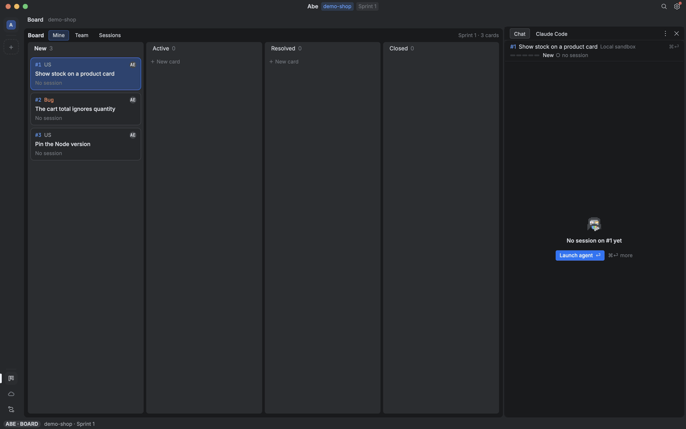
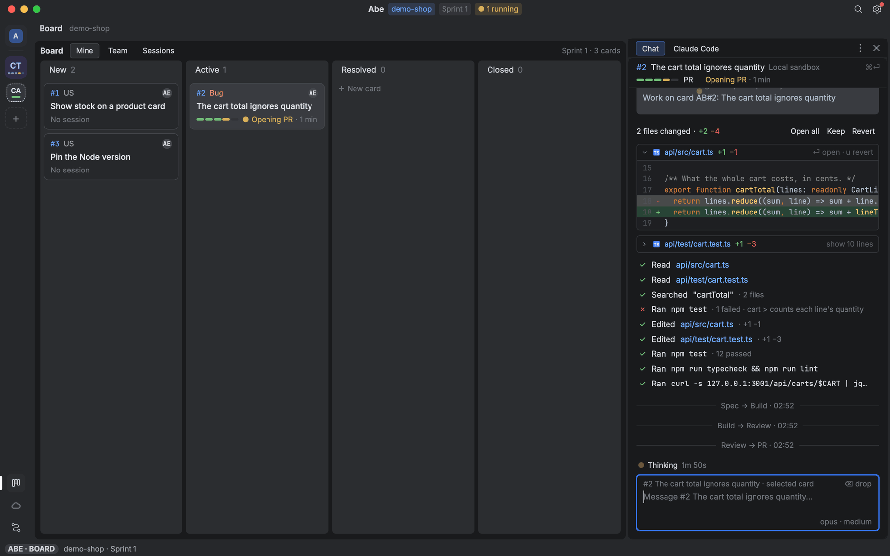
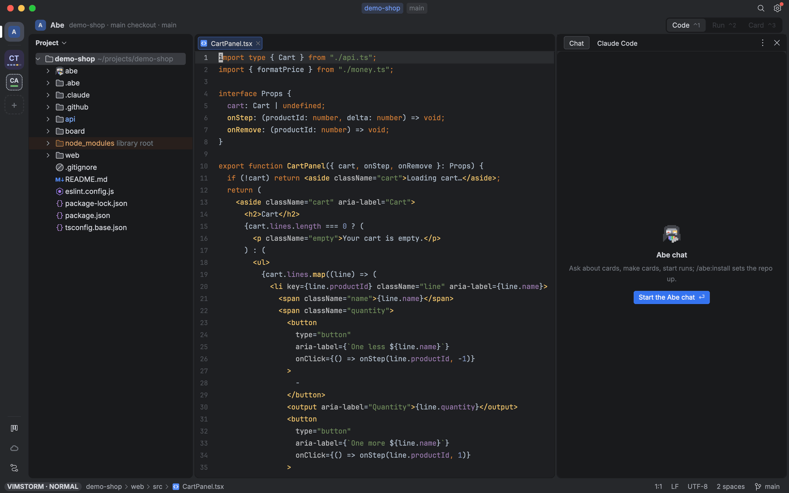
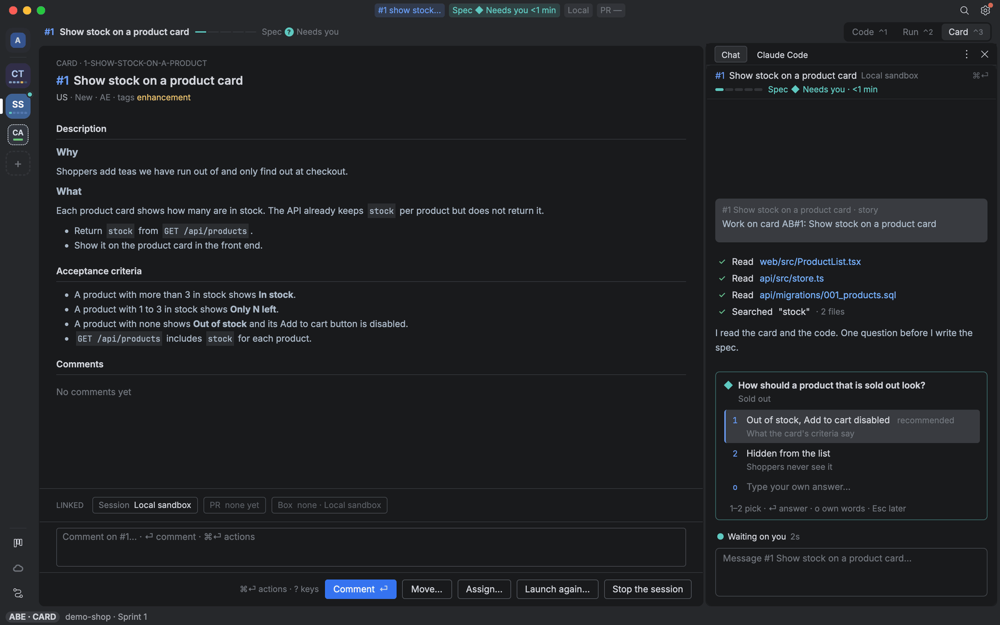
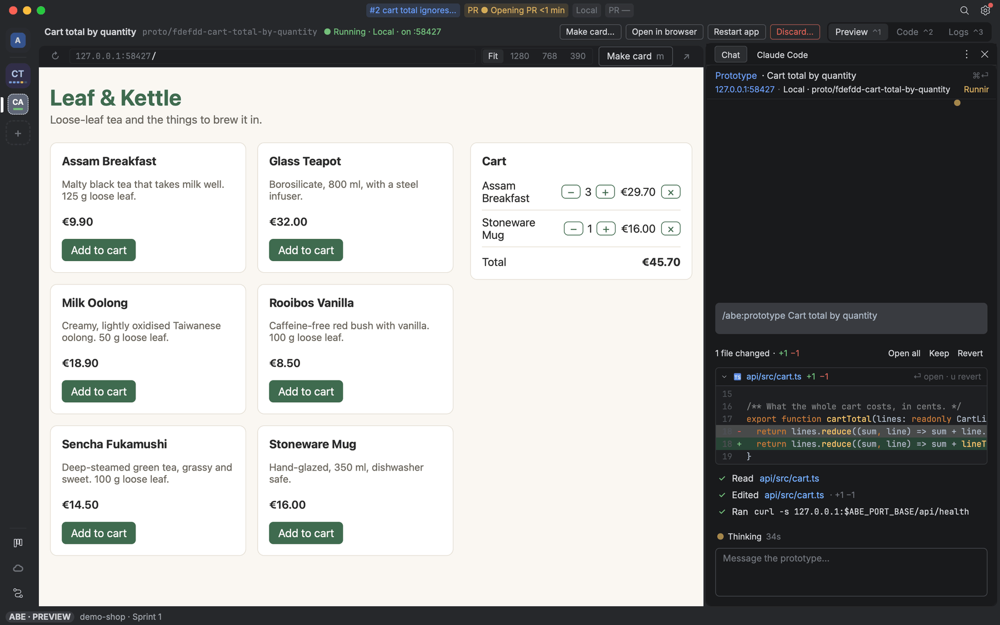
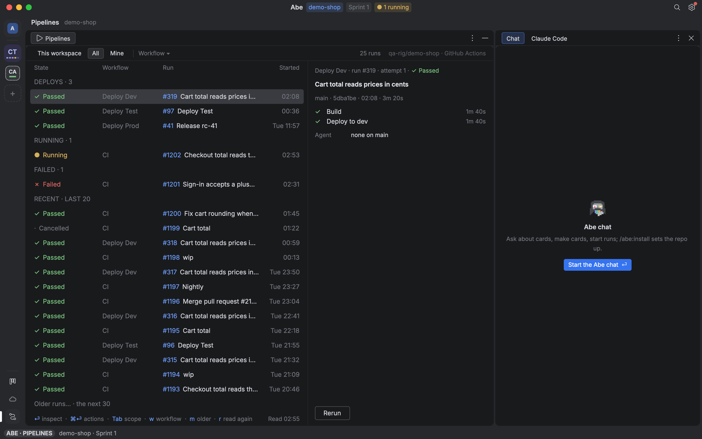
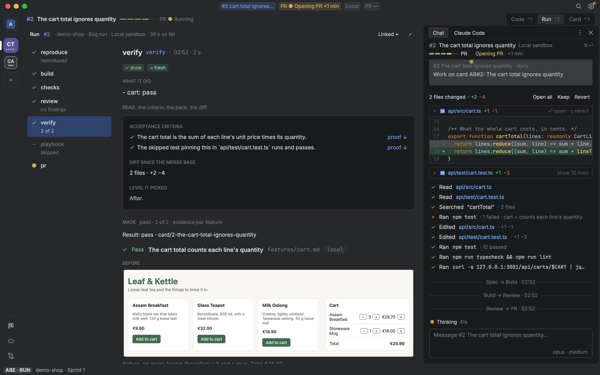

# VimStorm

**A native IDE shell around Neovim**, with Claude Code agents working your cards beside the code.

[](https://raw.githubusercontent.com/mkdir-swe/vimstorm/main/docs/media/flow.gif)

[Watch the video](docs/media/hero.mp4)

| Board | Editor | Chat |
| --- | --- | --- |
| [](https://raw.githubusercontent.com/mkdir-swe/vimstorm/main/docs/media/board.png) | [](https://raw.githubusercontent.com/mkdir-swe/vimstorm/main/docs/media/editor.png) | [](https://raw.githubusercontent.com/mkdir-swe/vimstorm/main/docs/media/chat.png) |
| **Preview** | **Pipelines** | **Run page** |
| [](https://raw.githubusercontent.com/mkdir-swe/vimstorm/main/docs/media/preview.png) | [](https://raw.githubusercontent.com/mkdir-swe/vimstorm/main/docs/media/pipelines.png) | [](https://raw.githubusercontent.com/mkdir-swe/vimstorm/main/docs/media/run.png) |

## What it does

Agents work in worktrees of their own. You stay in the editor and review what they did, with the proof next to the diff.

- **The editor.** A native Mac app around an embedded Neovim: file tree, tabs, Git, diff and merge, terminals, LSP. Vim keys or VS Code keys.
- **The Board.** Cards from GitHub Issues, Azure Boards or this Mac. ⏎ on a card starts an agent.
- **Sandboxed agents, local or cloud.** Each card runs jailed in its own worktree, on this Mac or on your own AWS box, where it keeps going after you close the laptop. Prod stays off until you turn it on.
- **Runs with proof.** A workflow (Bug, Feature, Quick fix or Investigate) runs your checks, then Verify drives the app in a browser and shows each acceptance criterion with its proof. You review the pull request in the editor.
- **The Abe chat.** One per repo, beside the code. It runs the rest:
  - `abe install` sets up any repo and writes its skills from the code.
  - It starts workflows on one card or many, and writes new workflows with you.
  - `abe improve` changes VimStorm when you ask: settings, keys, commands, views.
  - `/abe:prototype` builds throwaway code with a live Preview.
  - `/abe:retro` looks back over past sessions and fixes what went wrong.
- **One CLI, local or hosted.** `abe <noun> <verb> --json` drives it all, on this Mac or on your box over SSH.
- **A demo to start on.** `abe demo new` makes your own copy of a small shop.

## Requirements

- macOS on Apple Silicon.
- A Claude Code seat, signed in with `/login`. VimStorm uses no API keys.
- A GitHub account.
- A Docker runtime, such as Docker Desktop, OrbStack or Colima.

## Install

```sh
git clone https://github.com/mkdir-swe/vimstorm ~/projects/vimstorm
~/projects/vimstorm/install.sh
```

The script checks for Xcode Command Line Tools, Homebrew and Rust. It installs anything else missing with Homebrew, such as Neovim, bun, gh and tmux, and installs Claude Code. Then it builds `VimStorm.app` with Abe inside and puts `vimstorm` and `abe` in `~/.local/bin`. Running it again is safe. It installs no cloud tools; `install.sh --cloud` adds the AWS CLI for [running agents on your own box](docs/cloud.md).

Then follow [Getting started](docs/getting-started.md). It takes about ten minutes to get an agent working on a card.

## Docs

- [Getting started](docs/getting-started.md) covers logins, your own demo repo, Abe's install and ⏎ on a card.
- [Cloud](docs/cloud.md) sets up your own box on AWS, where sessions outlive the laptop.
- [Architecture](docs/architecture.md) explains the Mac's `abe serve`, the box's, and the link between them.
- [Reference](docs/reference/README.md) covers the window, the editor, keys and every part of Abe, by area.
- [Glossary](GLOSSARY.md) and [decisions](docs/adr/).
- [Contributing](CONTRIBUTING.md).

## License

Apache-2.0. See [LICENSE](LICENSE), and [app/NOTICE](app/NOTICE) for third-party notices.
