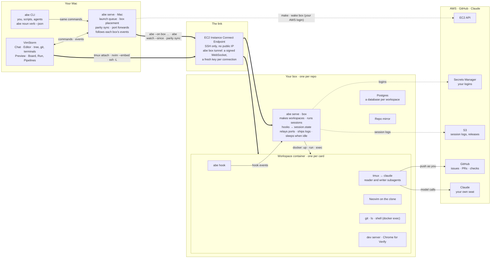
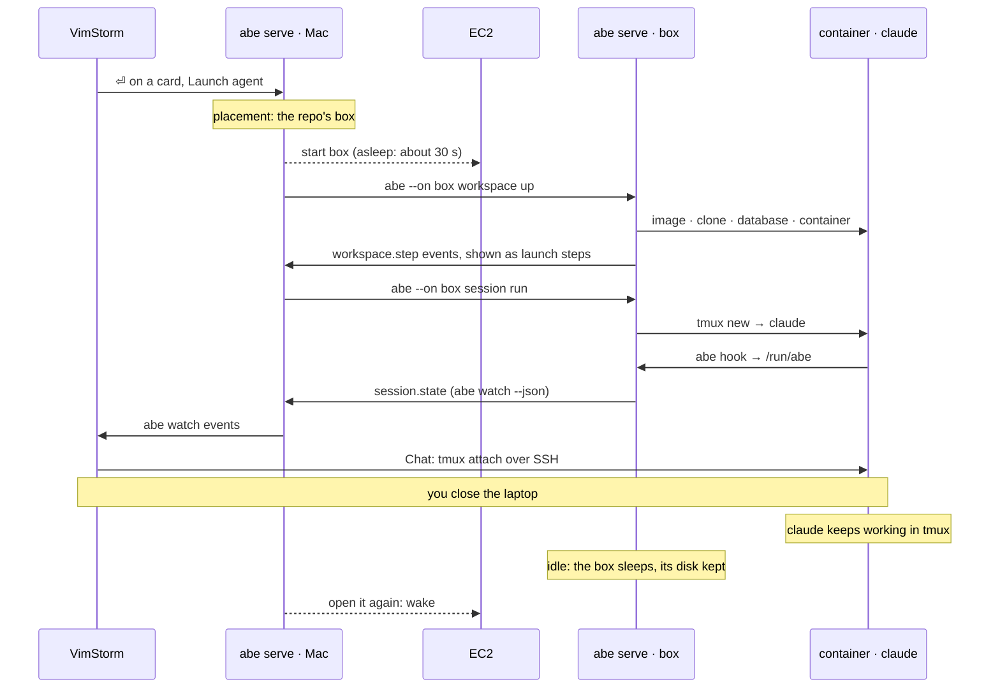

# Architecture

Every action in VimStorm is an `abe <noun> <verb>` command, so VimStorm, you, your scripts and the agents all drive the same process: `abe serve`, one per Mac. VimStorm draws Abe's screens from component trees that `abe ui bridge` sends it, and follows what happens through `abe watch`.

By default sessions run on this Mac: `abe serve` makes the card a worktree, starts Claude Code in tmux there, and VimStorm's Chat attaches to it. Nothing below the Mac is involved.

Once you set up [the cloud](cloud.md) (`serve.target: cloud`), agents run on your own EC2 box, one per repo, and keep working after you close the laptop. The Mac's `abe serve` then passes each command to the box's own `abe serve` over SSH, and the box runs Claude Code in one container per card. The rest of this page is that setup.

## The parts and the wires

Thick lines go over SSH through the endpoint; dotted ones are AWS calls made as you. Everything between the Mac and the box rides that one kind of link. VimStorm reads files on the box by running Neovim, git and `ls` there, so nothing is copied. The Mac's `abe serve` never runs an agent when the target is cloud: it starts boxes, passes commands to the box's serve and follows its events.

## Two serves, one contract

**`abe serve` on the Mac**

- What VimStorm and the `abe` CLI talk to. `serve.target` says where sessions go: `local` (the default) or `cloud`.
- Queues launches and puts each card on its repo's box.
- Makes or wakes boxes through EC2 with your AWS login.
- Parity sync: your uncommitted `abe.yaml` and skills, your Claude Code tokens and short-lived AWS keys, sent into the workspace on stdin (never an argument, never a log).
- Holds port forwards for the Preview, and follows the box's events, so `abe watch` on the Mac shows them.

**`abe serve` on the box**

- `abe workspace up`: the repo's image, a clone on the card's branch, a database in the box's Postgres, a container.
- `abe session run`: `claude` in tmux in that container, with a clean environment, Abe's hooks and the sandbox.
- Turns each hook into `session.state` and answers permission asks.
- Relays dev-server ports into the container and ships session logs to S3.
- Shuts the box down when it has been idle.

Both are the same `abe` build; the Mac checks the box's version and says so when they differ ([A new abe on your box](cloud.md#a-new-abe-on-your-box)).

## One launch, from ⏎ to steering

VimStorm shows each step (box starting, images, workspace, claude starting) from the box's `workspace.step` events. A box that is already up skips straight to the workspace.

## Why a session survives you leaving

- **tmux holds claude.** Claude Code runs in a tmux session inside the card's container. Chat is only a tmux client: closing it detaches and leaves the run going.
- **The box owns the session.** The box's serve starts and watches it. The Mac's serve keeps what it knows in its state folder (`cloud/<id>.json`), so a restart, and its launch queue, carry on.
- **Reconnecting is automatic.** `abe box attach` runs ssh again at once after a drop, then every half second, for up to five minutes. The endpoint cuts each tunnel after an hour and the loop reconnects.
- **No event is lost.** The Mac follows `abe watch --json` on the box and, after a dropped tunnel, resumes with `--since` its last event.
- **The box decides when to sleep.** No hook and nobody attached for `box.idleMinutes`: it warns, then shuts down and keeps its disk. A working session, an attached terminal, `abe box keep` or a run waiting on its pull request keep it up.
- **Waking is quick.** A stopped box resumes in about 30 seconds. A new box takes a few minutes: boot, the base image, the repo's image.

## Who can reach what

- IAM lets you act only on boxes tagged with your GitHub login (`abe:owner`), and your boxes run as your own box role.
- A box has no public address. SSH goes through the endpoint, signed with your AWS login, with a fresh ed25519 key pushed for every connection.
- Your logins (GitHub, Claude Code) are stored once in Secrets Manager and readable only by your boxes. Tokens never go on a command line or into a log.
- Agents get only what Reach gives them: Claude Code's permission rules plus its sandbox.
- Claude runs on your own seat through `/login`. There are no API keys and no per-token bill.

## Sessions on this Mac

With `serve.target: local` the same pieces run on the Mac: `abe serve` makes a worktree per card beside the checkout, starts `claude` in tmux there with the same hooks and sandbox, and gives the session a database of its own in a local Postgres container (`abe-pg`). Chat attaches to that tmux directly, and the Preview opens the app on a local port. `abe session move-to-cloud` and `abe session download` move a session between the two.

Drawn from ADRs 0015 (the CLI is the contract), 0016, 0020 (Claude Code is the only agent runtime), 0021 (our own box layer), 0022 (one box per person per repo) and 0042 (sessions run on this Mac until you set up boxes), and from `abe/packages`: `core/box`, `serve/box`, `ports/aws` and `ports/docker`. The details: [Boxes](reference/boxes.md), [Sessions in your environment](reference/cloud-sessions.md), [Sessions](reference/sessions.md).
