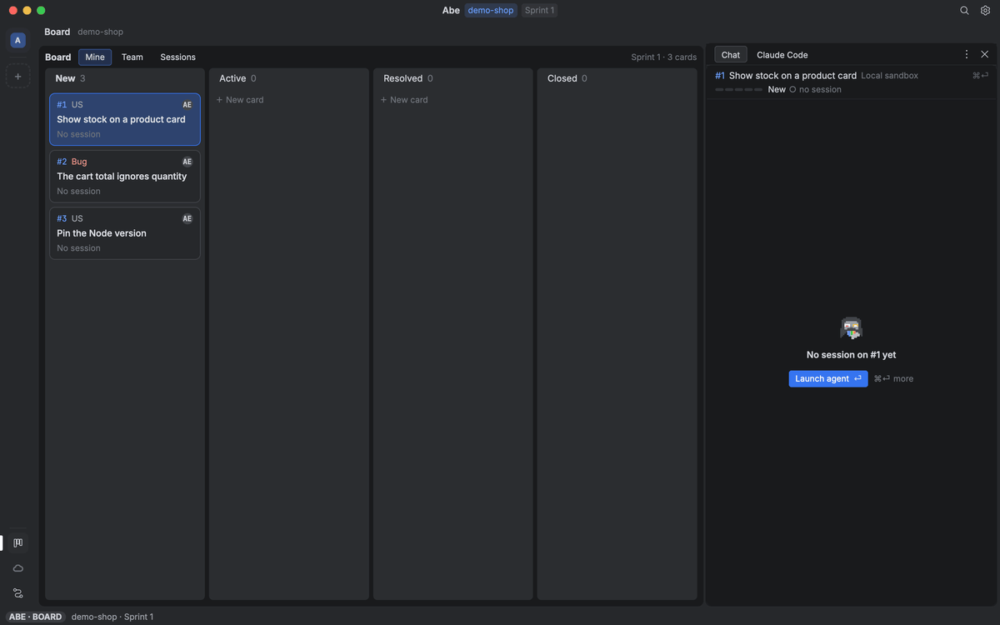

# Getting started

From a fresh Mac to an agent working on a card, in about ten minutes. Everything here runs on this Mac: you need no AWS account. Running agents on your own box comes later, in [Cloud](cloud.md).

You need macOS on Apple Silicon, a Claude Code seat, a GitHub account and a Docker runtime (Docker Desktop, OrbStack or Colima).

## 1. Install

```sh
git clone https://github.com/mkdir-swe/vimstorm ~/projects/vimstorm
~/projects/vimstorm/install.sh
```

When it is done, open a new terminal so `~/.local/bin` (where `vimstorm` and `abe` are) is on your `PATH`.

## 2. Log in

```sh
gh auth login        # GitHub: Abe opens pull requests and reads the repo as you
claude               # Claude Code; type /login, sign in, then /exit
```

Start your Docker runtime too: the demo's app has a database, and Abe gives each session its own.

Check that everything answers:

```sh
abe login status     # github and claude: ok (az matters only for an Azure Boards board)
abe tools check      # each tool ✓, or what is missing and how to add it
abe settings problems
```

## 3. Make your own demo repo

```sh
abe demo new
```

This copies the demo app that ships with VimStorm (a small shop: API, web app, migrations, tests) to `~/projects/demo-shop`, creates `<you>/demo-shop` on GitHub as a private repo under your own `gh` login, pushes it, and adds its cards as GitHub issues assigned to you. The repo's issues are its board: Abe reads and writes them with `gh`. Give it another folder with `abe demo new <folder>`.

If the folder or the repo is already there, it stops and says how to start over. Nothing of yours is published.

## 4. Let Abe set the repo up

```sh
cd ~/projects/demo-shop
abe install
```

`abe install` opens the repo's Abe chat, a Claude Code session in this checkout that works through Abe's install. It prints the session's id. Watch it in the terminal with `abe session attach <id>` (Ctrl-b d leaves it running), or in VimStorm in the next step.

The install reads the repo, asks a few questions (each with an answer picked from what it found), and writes:

- `abe.yaml`: the repo's settings for Abe (its board, its checks, when a card is done). With a GitHub origin and no board named, the install offers the repo's GitHub Issues first (`board: { provider: github }`).
- `.claude/skills/`: how the app runs (`run-app`), and a Verification pack, so an agent can start the app and check its own work.
- `abe/`: the workflows a card runs through.

It checks each part as it goes; `abe install status` shows where it stands. When it says Done, commit and push what it wrote, so every card's worktree has it:

```sh
git add abe.yaml abe .claude
git commit -m "Set up Abe."
git push
```

## 5. ⏎ on a card

```sh
vimstorm ~/projects/demo-shop
```

⌘⌥A opens the Board with the demo's cards: its open issues, the ones assigned to you on Mine. ⏎ on a card opens its page; its first action is Launch agent. A card assigned to no one asks you to take it first: ⌘⏎ on it, Assign… › Me. The session runs on this Mac, in a worktree of its own on the card's branch:

- **Chat** (the right column) shows the agent's turns as it reads, plans and writes code. Type there to steer it. ⌃⌘→ shows Claude Code itself.
- **The Preview** shows the app the agent is building, running on this Mac with its own database.
- **The Run page** shows the card's stages: the work, the checks, Verify driving the app in a browser.
- The card moves along the Board as GitHub labels: `active` while it is built, `resolved` after, closed when done ([the board](reference/board.md#github-issues)).
- At the end a **pull request** opens on `<you>/demo-shop` for you to review and merge. Agents never merge.

[](https://raw.githubusercontent.com/mkdir-swe/vimstorm/main/docs/media/board.gif)

macOS may ask once whether VimStorm may find devices on your local network. That is Abe reaching a server on this Mac (127.0.0.1); Allow is safe.

## When something is missing

- `abe tools check` names each tool Abe runs and how to add a missing one.
- `abe settings problems` lists what is wrong with your setup, worst first, each with its fix.
- `abe login status` says which login has expired and how to sign in again.

## Next

- Your own repo: `cd` to its main checkout and run `abe install` there.
- Agents that keep working after you close the laptop: [Cloud](cloud.md).
- How the pieces fit: [Architecture](architecture.md). Everything else: [the reference](reference/README.md).

A note on words: **Local mode** in Abe is something else. It makes a repo's board read-only and holds every write on this Mac until you merge or discard them (`abe local on`). Sessions running on this Mac, as here, write as usual.
