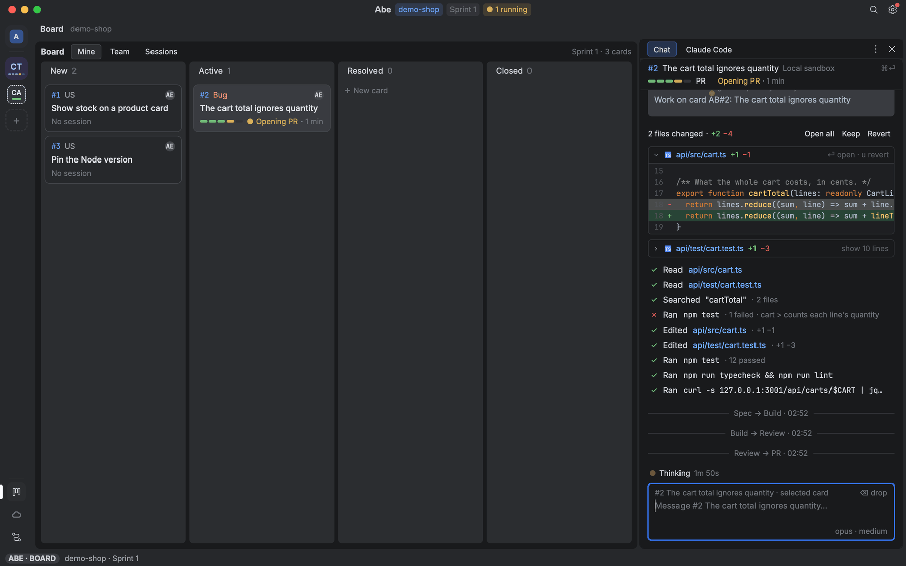

# The board

Tracking, the Board's data, fresh data, Linked, Sheets, and Local mode (the board read-only, every write held on this Mac).

## Tracking

ADR 0009. Issues, sub-issues, pull requests and deployments on GitHub as the person, through `gh` on its own keyring login (`ports/src/github/tracking.ts`; GitHub's states read by core's `checkRunState`, `checksState`, `deployState` in `core/src/board/tracking.ts`). Commands: `abe issue show <owner/repo>#<n>`, `issue create --repo … --title … --body-file … [--label …] [--parent <n>]` (a sub-issue of `--parent`), `abe pr show <ref>` (state, head, base, mergeable, its head's checks: the newest Actions run per workflow and the commit statuses, never check runs, which a fine-grained token cannot read; the merge commit once merged), `pr create --repo … --head … --base … --title … --body-file … [--draft]`, `pr update <ref> --body-file … [--title …]`, `pr merge <ref> [--method squash|merge|rebase] [--sha …]` (a person merges: never from inside a session), `abe deploy status --repo … --sha … --env …` (the commit's newest deployment there and its state). The port also finds the open pull request on a branch (`prFind`) and writes an issue or pull request comment (`issueComment`, not used by a command yet). Error codes: `not-found`, `auth`, `rate-limited`, `gh-failed`.

## The Board

`abe card list | show | images | comment | tag | move | assign | members` work on the board the merged `board` setting names (the repo's, ADR 0030): `organization` (`https://dev.azure.com/<org>`; no other host gets the token), `project`, `team`, `types` (default `User Story`, `Bug`), and, for a board several repos share, `area` (an area path: the cards under it) and `tag` (the cards carrying it), which cards are this repo's; `excludeLanes` (swimlanes: `System.BoardLane`, set by the board of the team owning the card's area path) and `notTag` (a tag), the cards it leaves out, such as an `External dependencies` lane of cards waiting on other teams: card lists, triage, the Board, the changes feed and Factory runs in the checkout read only those, all in the one WIQL (`cardsQuery`: `([System.BoardLane] NOT IN (…) OR [System.BoardLane] = '')`, so a card in the default lane, whose lane is empty, stays; `NOT [System.Tags] CONTAINS …`; the Connection check shows them), and triage leaves out the GitHub issues labelled `notTag` (`itemsToTriage`). Each card says its lane (`lane`, absent in the default lane). `provider` is `azure`, `local` or `github` (`azure-boards`, `azure-devops` and `ado` read as azure, `github-issues` and `gh` as github; `github-projects` and `jira` are accepted but have no cards in Abe yet: `boardOf`, `settings problems`, the Connection fact and the end of Board say "<provider> has no cards in Abe yet"; a word no board has is refused by `settings check`). The port is `Board` in `core/src/ports/ports.ts`; the adapter (`ports/src/azure-devops/board.ts`) takes its token from `az account get-access-token`, renews it once on a 401 and turns html into markdown (`ports/src/azure-devops/markdown.ts`). `card images <url…>` reads each image that is an attachment of the board's organization (`boardAttachment`: `https://dev.azure.com/<org>/…/_apis/wit/attachments/<id>`, the org's `visualstudio.com` name read from dev.azure.com, no redirect followed, a png, jpg, gif, webp or bmp told by its bytes, at most 20 MB; never SVG) into `<state>/images/<hash>.<ext>` (0600), kept and never read again, and answers any other with why it was not read. What Azure's answers mean (tags, a bug's repro steps as its description, a team's areas, the WIQL, error codes) is `core/src/board/board.ts`'. `ABE_ADO_BASE_URL` sends every request to a fake Azure DevOps instead. `card list` names the team's current sprint (`sprint`, null when none or its read failed) and lists open cards; `--closed` adds the done ones (Closed, Done: `DONE_STATES`) of that sprint, else of the last `DONE_DAYS` (14) days by `@Today`, never a Removed one; a run's pull request in `factory status` carries its `checks`.

### GitHub Issues

`board: { provider: github }` makes the repo's GitHub Issues its board (`boardOf` gives `provider: 'github'`, `repo: <owner>/<name>`, organization `https://github.com/<owner>`, project the repo, team `Issues`). Its repo is the checkout's origin (the main checkout's `.git/config`, filled into the setting by serve's settings, `githubBoardFilled`) unless `board.repo` names another; no GitHub origin and no `board.repo` is `no-board`. It is read and written through `gh api` as the checkout's gh login (`logins.gh`, else gh's active one; `ports/src/github/board.ts`), its rules in `core/src/board/github-board.ts`. A card is an issue, never a pull request; its id is the issue's number, named `#4` in commits, pull requests and the launch prompt (`boardCardName`). Columns (`githubCardState`): open with no column label is New, the label `active` Active, `resolved` Resolved; closed as completed is Closed, as not planned or a duplicate Removed (never listed). Its types are `Issue` and `Bug` (an issue labelled `bug`); its tags are the other labels; `tag` and `notTag` are labels; `area` and `excludeLanes` are Azure's and refused (`bad-board`). A body's `## Acceptance criteria` heading splits off the card's criteria and is written back so. Yours (`card list --mine`) is assigned to your gh login; a card's assignee is its first. Writes: `card move` sets the column label (the other's off) and opens or closes the issue (`New`, `Active`, `Resolved`, `Closed` or `Done`, `Removed`; any other state `rejected` naming these); `card assign` sets the issue's assignees (`me` your gh login, `none`, a login), and one GitHub leaves out (no access to the repo) is `rejected`, never dropped; `card members` is the repo's assignable people; `card tag` sets labels (a column label is refused: move the card); `card comment` an issue comment; `card create` a new issue (its type's label, its column's label, assigned to you with `--assign me`, a sub-issue of `--parent`); Make card's edits the title and body. GitHub has no sprints (`card list` names none, `--closed` adds the issues closed as completed in the last `DONE_DAYS` days), and no API for a card's images or attachments: `card images` and attachments are `unsupported`. The changes feed reads the issues changed since the last look (`since`, a second after the newest change). gh's failures read as `auth`, `not-found`, `rejected` (HTTP 422), `offline` or `gh-failed`. No az is needed (`abe tools check`).

`abe card assign <id> me` (a person only) sets `System.AssignedTo` to the login Azure DevOps knows the token by (`GET <org>/_apis/connectionData`, `authenticatedUser.properties.Account`), so the card is then in `card list --mine`; `none` clears it; anything else is a teammate, found among `card members` by email, name or the email before the `@` (any case; `assignTarget`), else `not-a-member` naming them, one fitting two refused the same way, an email not on the team written as it is. `abe card members` lists the board's team (`GET <org>/_apis/projects/<project>/teams/<team>/members`, groups and inactive logins left out), each `{name, email, you}`, you first, then by name A–Z (`membersInOrder`). `abe card checkout <id> [--repo <checkout>]` (a person only; the local serve only, else `no-checkout`) fetches origin and checks out the card's branch as origin has it (`card/<id>` or `card/<id>-*`, the newest commit when there are more) in a worktree beside the main checkout (`<repo>-wt/<id>-<slug>`, tracking origin's; a local branch of that name fast-forwarded to it), or answers the worktree it is checked out in already (`made: false`); none on origin is `no-branch`. Only the fetch reaches GitHub, so local mode holds nothing. `card comment` takes `--text <markdown>` or `--body-file <file>`, exactly one (else `usage`); blank is `empty-body`. `abe card create --title <t>` writes a new card (a session only a ticket of its own card, `--parent <its card>`, else `not-your-session`; Azure links it as the child, this machine's board keeps `parent`): `--type` one of the board's (default its first; another is `rejected` before anything is sent), `--state` its column (one its type has, else `rejected` naming the type's states), `--assign me|none` (default none), `--sprint current|none` (default the team's current sprint when it has one), `--description` / `--criteria` (markdown; or `--description-file` / `--criteria-file`, not both); a value starting with `-` goes inline (`--criteria=- [ ] …`). `abe card draft <words…>` answers `{title, why, what, criteria}` from a one-shot (the make-card skill's card part; `--earlier <json>` its last draft, `--session <id>` an Ask chat's conversation read in); it writes nothing.

## Fresh data

#236, decision one rule for all outside data, run by `serve` (`serve/src/board/fresh.ts`, the rules in `core/src/board/fresh.ts`). A look is one cheap changed-since read per outside system: Azure DevOps' `Board.changes` (`System.ChangedDate > <where the last look's query ran, its asOf>` with `timePrecision`, on the board's project and types in any state and area, oldest first, at most 200 a look; usually empty, one WIQL; else only the changed cards are read, with the board's own `card list --closed` query on their ids to say which it lists now and which are on Mine, the rest `gone`: off the board now, or never on it), GitHub's `recentPrs` (the 30 last changed pull requests in any state; a review, a push or a merge changes a pull request's `updated_at`), compared with what the last look saw (`changedSince`: the newest change and the items at that moment; never the local machine's clock), and the 30 newest runs of the pipelines provider in force (`Pipelines.runs` on the `pipelines` setting's source: GitHub Actions or Azure Pipelines), compared run by run with the last look's (`runsMoved`: new, run again, another status, finished). Each part is read and fails on its own. The first look at a board or repo only finds where the next one starts; looks at one board or repo from two checkouts go in turn, so a change is said once. What changed is an event: `board.changed {board, cards: [{card, mine}], gone}`, `github.changed {repo, prs}`, `pipelines.changed {source, runs}`; a quiet look says nothing. No Service Hooks.

- `abe fresh` looks now in the checkout it was typed in (its `board` setting, its origin on GitHub) and answers what it found; looks asked together are one, and one asked within 5 s of the last gets that answer (`FRESH_AGAIN_MS`). `abe fresh --follow` holds the checkout while its connection stays: a look at once, then every 2 min (`FRESH_EVERY_MS`; `$ABE_FRESH_MS` shortens it for tests), its changes streamed as `abe watch` frames.
- The bridge holds `abe fresh --follow` in the shown folder while the app's `window` frame says the Factory view is shown (again after a break, waiting longer each time it keeps ending, never again after a serve that answers it with a reply; anew for another folder) and asks `abe fresh` whenever the window comes to the front, either view (the Board and Linked follow from the Editor too). The Board puts each `board.changed` card in its place on both tabs (Mine only when it is yours now, `keptOrder`) and takes the gone ones off, reading nothing; Linked reads the part again: `card` for its story, `pr` for its pull request or one on its branch, `pipelines` for a run on its branch (the branch its work was read on, `StoryLinkedData.branch`, else `card/<id>[-slug]`).
- Not seen: a card deleted to the Recycle Bin (WIQL no longer finds it; the next whole read drops it).

## Linked

2.1. `abe story linked <id>` answers Linked's nine rows for a story (3.0: no Run row, Run is on the stripe), always these, in this order: Story (column · type · assignee's initials), Prototype (the version its run was built from, `v2 · v3 is newer` when a newer one was made since, a developer's `proto/2-vat at c0ffee0`, dim `none`; the org store's newest version read with the run part; ⏎ opens that version as your copy: `open factory {card, show: prototype, version}` → `prototype show --card --version`), Spec (the run's spec issue, the spec it wrote (a prototype's run's too), `none · Bug writes no spec`: its workflow has no spec step), Sessions (count · where each runs · subagents working), Pull request (`#10 AB#102 Count each line's quantity in th… · checks ✓ 3/3 · 1 review`, its title cut at 40 whatever its state: the run's, else the open one of its branch), Pipelines (the branch's newest run from the provider the `pipelines` setting names, GitHub Actions or Azure Pipelines, `ci ✓ passed on card/2-…`, how long ago; ⏎ opens it in the Pipelines tab, read there by its id when older than the latest runs listed), Worktree, Box (`demo-shop-102 · running · stops at 01:30`, `none · Local sandbox`, `none yet` before a session), Sheets (yours for the story and those attached to it). Each row: `words`, `time` (`{since, ago}`, said after the words), `dim` (nothing there, `none yet`, or not read), `error` and `opens` (what ⏎ opens, null on a dim row); `run` carries the run's facts for its StageRail. A part that could not be read says `not read · <why>` on its own row; the answer never fails whole. Schema and text in `core/src/board/linked.ts`; the rows in `ui/src/linked/linked-rows.ts` (`linkedOf`, beside the header's `lookOf`, which core cannot import) with the live rule `linkedOnEvent` (an `abe watch` event of the story moves the Run row in place and asks for the command again; a gap too); the reads in `serve/src/board/linked.ts` (`readLinked`: the card, `factory status <id>`, `session list`, `sheet list`, `box list` when a session is on a box; GitHub by the pull request's or session's repo, else the worktree's origin: `Tracking.prShow` / `prFind`, `prReviews`, `issueShow`; the branch's run through `Pipelines.runs` on that branch, `newestRunOn` in `serve/src/board/pipelines.ts`).

## Sheets

A Sheet is one self-contained HTML page an agent makes to show something. Rules in `core/src/sheets/sheets.ts` (the self-contained check `selfContainedProblems`, `planSave`, the fuzzy find `rankSheets` / `listOrder`, refs, org store keys, `SHEET_CSP`), handlers in `serve/src/sheets/sheets.ts`, core's instructions to agents in `core/src/skills/instructions.ts`.

- `abe sheet save --title <t> --file <page.html> [--card <id>] [--session <s>]` keeps it in your environment: `serve`'s state directory (`<state>/sheets/<id>/v<n>.html` beside `meta.json`), the box's when `serve` runs on one. The same title (any case) again is the next version; the id is the title's slug and a random suffix, unique across the org. A page with an external `src`, a stylesheet or resource `href`, `@import`, a `url(…)` that is not `data:`, or a `fetch` / `XMLHttpRequest` / `WebSocket` / `EventSource` URL is refused `sheet-not-self-contained`, naming each.
- `abe sheet list` / `find <name…>` put the current card's and session's first (`--card`, `--session`; on a box, its workspace's card). `show <id> [--version n]`: path, title, card, versions, attached.
- `abe sheet attach <id> --card <card>` copies the newest version to the org store (`sheets/<card>/<id>/v<n>.html` and `sheet.json`) and writes nothing on the card (`NOT_COMMENTED`, ADR 0038): `abe card show` lists the card's Sheets from the store.
- `abe sheet open <id>` (yours) or `<card>/<id>` (anyone's attached one) answers a URL on 127.0.0.1: an origin of its own per page and version, serving that page at one secret path with `Content-Security-Policy: default-src 'none'; img-src data:; style-src 'unsafe-inline'; script-src 'unsafe-inline'` and 404 for anything else.
- Events `sheet.saved`, `sheet.attached`.
- The org store (`OrgStore` in `core/src/ports/ports.ts`: `put` / `get` / `list` by key) is `$ABE_ORG_STORE=s3://<bucket>[/<prefix>]` (the org's bucket in the tooling account, the org Terraform's `terraform/org-store`; `ports/src/aws/s3-store.ts` through `aws`) or `file://<dir>` (`ports/src/aws/org-store.ts`, tests); without one, attach is refused `no-org-store`. `SheetHost` (`ports/src/mac/sheet-host.ts`) serves the opened pages.
- In VimStorm: `:show <name>`, Chat's `Show <title>` link and the card dialog's Sheets open one as a tab with no network; see The shell bridge, Sheets in the shell.
- Tests: rule tables in `core/src/sheets/sheets.test.ts`; the CLI seam (the org store a folder, the fake Azure DevOps, the page's origin read over HTTP) in `serve/src/sheets/sheets.test.ts`.

## Local mode

(`core/src/local-mode/local-mode.ts`, `serve/src/local-mode/local-mode.ts`). `localMode` (yours on this machine alone, ADR 0030) lists the checkouts (top folders) in local mode; `abe local on|off` in a checkout puts it on or takes it off (a card worktree counts as its checkout, `localCheckoutOf`). There Abe reads as usual (the board, issues, pull requests, CI, deploys) and holds every write on this machine: `serve` wraps the request's Tracking, Board, Git and Pipelines ports (composed once per request at its checkout by `serve/src/routing`, with your gh login, az folder and box profile there), a run's card moves (by its card's run) and the pr stage's reads, in core's held decorators (`heldTracking`, `heldBoard`, `heldGit`, `heldPipelines`, `heldReview` by the review's `--path`, `heldLayerPulls`), which record the write (`HeldWrite`: when, what, where it would have gone, what ⏎ opens; a body kept as a file) and answer as if it had happened; event `local.held`. Card moves, assignments, tags, edits, comments, new cards, attachments, issues (a spec), issue comments, pushes, pull requests, merges, pipeline reruns, cancels, approvals and workflow runs, PR reviews, inline comments, replies, resolves, review requests, ready, close, Draft PRs and Layer proposals; nothing else writes (Improve retro's pull requests are only read). Local numbers sit above `LOCAL_FLOOR` (`#L3`), so none is sent to GitHub or read as one of its. A new card (Make card on a prototype with no card, which local mode refused before; `card create`) is a held card: kept here (`HeldStore.cardCreate`, records' `heldCards`), its id a local number read `LC<n>` (`localCardName`, `cardName`; `parseCardId` takes `LC3`, `#LC3`), its url `local:LC<n>`; `heldBoard` lists it beside the board's cards (Removed never, done ones only with `--closed`, Mine's when it is yours or made by you), reads it, and every move, assignment, tag, edit and comment on it is held and kept on it, so it is opened, moved and launched on this machine as any card (`cardRoutedBoard` finds its checkout when no run says one); like a local pull request it never reaches the board, and turning local mode off leaves it a record. A held tag change keeps its tags (`HeldWrite.tags`), and `heldBoard`'s `list` and `show` put them on the board's card (`withTags`), so a held `prototype` tag makes the card ask "can we do this?". Agents run on this machine only: `factory run --target cloud` is refused `local-mode`, a `serve.target: cloud` launches here (`placement`), Move to cloud is refused. The pr stage's `abe factory pr` checks the body as ever, holds the push and opens a local pull request (`LocalPr`, `L<n>`, its body, head commit and base, and as git says when it is opened or updated `LocalMerge.changes`: their merge base `baseSha`, its `files` with lines added and removed, its `commits` oldest first; `prFind` answers only local ones, so a pull request on GitHub is never updated); `serve` never merges it (no auto merge) and its Done is the merge (`factory.done` reads `merged`). `abe local merge L<n>` (a person, never a session) squashes it into the local base with git's plumbing (`LocalMerge`, `ports/src/git/local-merge.ts`: `merge-tree --write-tree`, `commit-tree`, then a fast-forward where the base is checked out and clean, else the ref moved; `conflicting`, `base-dirty`); the run's next read sees it merged and it is Done, its card's move to Done held too. `abe local discard L<n>` closes it unmerged (the run needs you: closed without a merge). `abe local status` is `LocalModeView`: on or off, the checkout's held writes newest first, its local pull requests and each card's local state over the board's (`LocalCard`, its last held move and assignment, the tags held changes put on and took off); event `local.pr` on each local pull request's change. Records: `<state>/local/records.json`, files under `<state>/local/files/`. Turning it off sends nothing held (no Publish): they stay a record. On the Factory view (`ui/src/board/local-view.ts`, components `LocalBand`, `LocalPullRequest` in `ui/src/board/local-components.ts`, Rust `app/src/factory/local.rs`; boards LM-Board, LM-Held, LM-PR): the Board reads `local status` and follows `local.held` / `local.pr`; while on, a dashed band over it (`N held writes` opens Held writes, `Settings` the Local mode page), the toolbar's Factory line a dashed `Local mode · nothing written` badge (a click: Held writes; each of the checkout's workspaces `Local mode`) and the crumb `· local mode`; a card a held move put elsewhere than the board says is dashed, `Resolved here · Azure: Active` (`cardLocal`), in its board column; one a held tag change touched `+prototype here · not on Azure`; a held card `New here · not on Azure`, named `#LC1` (Rust's `card_name`). A held card made or written, or a held tag (`heldOnBoard`), reads the card lists again. Held writes (`:held`, a wide Command mode list, on or off) is newest first, when, what and where it would have gone; ⏎ opens its local pull request in the Board's place (its line with `2 files · +65 −3 · 2 commits` from `localPrStat`, Files with each one's +/−, Commits with sha and subject, then Merge locally · Discard, each asked first, `abe local merge|discard`; Diff, ⌘D or a file row's click, is VimStorm's diff viewer on its files from `baseSha` to `headSha` in its checkout, the `show-diff` a pull request review sends, open, merged or discarded alike), the file of what it would have sent, or the card. A run's local pull request is also the card menu's Open pull request (`#L3 · on this machine`), never a URL. Settings › Abe › Local mode (LM-Setting) is `localMode`'s home: the shown checkout's checkbox (`local status`'s `on`, flipped at once with `local on|off`, never staged), what local mode means as fixed lines, then every checkout your Layer lists.

### Read-only board and the board On this machine

A **read-only board** holds the board's writes alone (`boardReadOnly`, your Layer alone, a list of checkouts like `localMode`; `abe board read-only on|off`, a session may only turn it on; `off` and `abe local off` drop the key with its last checkout): `serve` wraps the Board port in `heldBoard` where `localMode.boardHeldAt(dir)` says so, which is local mode's checkout or one listed read-only, so local mode makes the board read-only too (read-only alone refuses `card assign` as `board-read-only`: a held assignment would change nothing the board, `card show` or a launch reads; the Board's grey launch rows say read-only is why) and there is one rule. A session launched there is denied `az boards work-item create|update|delete|relation` (`BOARD_WRITE_DENY`, which local mode's deny list includes); pushes, `gh`, `aws` and `az repos` stay allowed. Its held writes are the board's **local changes**, drawn over its real cards: `list` and `show` put held tags and edits (`HeldWrite.fields`) on the card and held comments (`HeldWrite.text`, by `you (held here)`) after the board's; `LocalCard` counts `edited` fields and `comments`; `LocalModeView.readOnlyBoard` says it is on. `abe board discard` (Discard local changes, a person) drops the checkout's held `card-*` writes and its held cards (`BoardDiscardData`), event `local.discarded`; held pull requests, pushes and issues stay. The install's Connection check shows `Writes · read-only` on such a board.

A board **On this machine** is `board: { provider: local, project?, team?, types? }` (`boardOf` gives `provider: 'local'`, organization `this machine`): `ports/src/mac/local-board.ts` keeps its cards, states (New, Active, Resolved, Closed, Removed), comments and new cards in `<state>/local/board/<project>.json`; urls are `local:<project>#<id>`; it has no sprints or images. Every caller reads and writes it through the same Board port (`boardsByKind`); `heldBoard` passes it through, so it is never held. The install offers it in the board part's question (written by the agent, named after the repo folder), and the Connection check shows it with its newest cards.

Without a team log store (`stores.logs`, `$ABE_LOG_STORE`), the Mac's `serve` ships to `<state>/logs/` (`fileLogStore`), so `abe improve retro me` works on a local install; it still keeps local mode's session logs in `<state>/local/logs/` (`LogShipper.storeAt`); `abe improve retro` and `log list` there read them, never the team's store.

A read-only board (`boardReadOnly`, `abe board read-only on|off`; local mode makes it read-only too, `LocalModeView.readOnlyBoard`) on the Factory view: with local mode off its own dashed band (`Read-only board`, `N local changes` opening Held writes as `Local changes`, only the board's, kept until discarded), and in either band `Discard local changes` while a board write (`card-*`) is held; it, `:`'s `Discard local changes…` and `:discard-local` ask first (`discardLocalConfirm`, `abe board discard`). `local.discarded` for the checkout drops them in place and reads `local status` and the card lists again. A card's dashed line also says its held edits and comments (`+prototype, edited, 2 comments here · not on Azure`; after a move's states `· edited`); a held edit reads the card lists again. A board On this machine (`organization: this machine`) has no read-only band and no dashed line, and no card with a `local:` url offers Open in browser.
