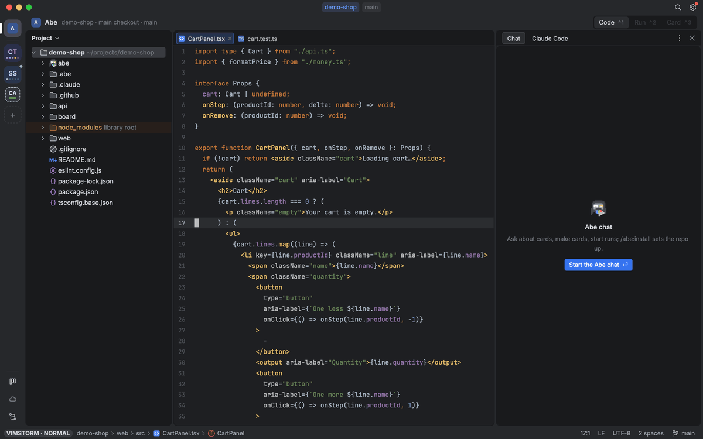

# The editor

Mouse and menus, the file tree, Git, editing, search, code navigation and Copilot.

## Mouse and menus

Everything works with the mouse as well as the keyboard. **Right-click** anything for a menu of what you can do there; **Cmd+Enter** opens the same menu at the cursor (in Abe's views the Action menu: the commands for what is in focus, a key dim only where Key overrides gave one; a click on a tab switches it). In a menu or any other popup list (Recent Projects, Branches, the Git log's filter pickers, usages): ↑↓ / Ctrl+N Ctrl+P / Tab to move, just type to filter (every letter types, `k` `l` `ö` `ä` too; `/` works too), Backspace edits it, Enter or click runs, Esc clears the filter / closes; pickers (Search Everywhere, Find in Files…) close on the first Esc or a click outside them (also in the Project tool window). Each item shows its shortcut. Abe's menus and Command mode show 12 rows at a time and a scrollbar beside them when there are more (the wheel moves the selection there). Code actions (Alt+Enter) and confirmations use the same popup. A long question wraps in the popup's title; what a menu only says ("No recent searches") is a dim line, never a grey item. In Branches… (also **Git › Branches…** / **New Branch…** in the menu bar) a branch opens its actions beside it with Enter, → or a click: Checkout, New Branch from '…'…, Compare with Current (the Git Log on `current..branch`), Rename…, Delete… (asked first, Cancel is the default, `d` deletes); Esc goes back to the branches.

| Where | Click | Right-click / Cmd+Enter |
|---|---|---|
| Code | caret; click a change marker in the gutter → show the change (rollback there); click `{...}` of a folded region → unfold; hover over code → error / documentation tooltip; markdown: the mode icons at the top right, drag the line between the text and the preview (each at least 20 columns; the share is kept, and the next preview opens at it) | context actions, go to / usages, quick definition, rename, reformat, cut/copy/paste, replace, folding › (expand / collapse / all), rollback lines, annotate, history, bookmarks › (toggle with number, go to), copy path, markdown Editor Only / Editor and Preview / Preview Only, split right / down, split and move, move to opposite group, close split / tab |
| Tabs | switch, × or middle-click closes, ‹N / N› hidden tabs | close / others / left / right / all (this split), split right / down, split and move, move to opposite group, select in tree, copy path |
| Tree | select, double-click opens, click a chevron opens/closes folder; Shift+click selects a range, Cmd+click / Alt+click adds / removes a row; no title bar: the project root is the top row | new, open, cut/copy/paste, copy path, rename, copy, move, delete, find in folder, open in terminal, reveal in Finder, history, select opened file, collapse all (below the rows: project menu); on a multi-selection: open all, cut/copy/paste, copy / move / delete all, reveal |
| Board | select a card, double-click opens its Card page (as ⏎) | the card's menu (as ⌘⏎) |
| Abe's views (Chat, Card page, Run, Pipelines, Boxes, Sessions, Settings) | their words select as any text view's: drag from where you pressed, double-click a word, triple-click a paragraph or a log line, ⇧-click extends (a click still does what it did); ⌘C copies plain text in reading order (a line between texts, a space between texts side by side, a blank line between blocks; code and logs keep their lines, a log line its words without its number and time), ⌘A takes the whole view once something is selected, Esc or any other key lets it go; a composer with the keys keeps them (⌘C there copies the selection only while its own field has none) | as before |
| Git panel | tabs, search field toggles (`.*` regex, `Cc` match case), filter chips (× clears that filter at once; right-click: Filter by… / Clear Filter), toolbars (Local Changes: Refresh / Rollback / Show Diff / View Options (Group by Directory) / Expand All / Collapse All; Log: Refresh / Cherry-Pick / View Options / Go to Hash/Branch/Tag; the commit panel's Commit / Commit and Push… / Amend), checkboxes (on groups / folders: all their files), chevrons; click the hash in commit details to copy it; double-click a file → diff, a folder → fold | per row: commit actions + filters (Log), diff / jump to source / mark / commit / push / rollback / add (Local Changes), expand / collapse all (changed-files trees) |
| Diff | `»` applies that change, wavy line unfolds; drag the divider between the panes (or `:vertical resize`), the panes keep that share, double-click it for equal panes; toolbar ↑↓ change, ✎ open in editor, ←→ file, Do not ignore / Highlight words dropdowns, ✕ close; marks at the pane edge show where changes are | next / previous change, revert, next / previous file, open in editor, whitespace mode, highlight mode, fold, close |
| Merge | `»` / `«` accept that side for the conflict; drag a divider (double-click: three equal sides); toolbar Accept Left / Accept Right (whole file), Apply, ✕ | accept yours / theirs / both, mark resolved, save, accept left / right (whole file), open in editor, close |
| Annotate | click a line's annotation → commit in the log | |
| Terminal (Code's bottom panel, ⌘T) | header: the panel's tabs (Terminal · Git · Problems), then its shells: click a tab, × or middle-click closes it, `+` new tab, ⋮ menu, Hide; the last tab's exit hides it; click into it to type (also from another pane or its find field); drag selects from where you pressed, double-click a word (`word-one`, `~/a/b.ts`: only blanks and ' " $ ( ) [ ] { } < > end it), triple-click a line; Cmd+C copies it (a long line wrapped on screen as one line, no line break at the end) and you type on; Cmd+V / Esc with a selection: back to the shell; find field: ↑ ↓ × | copy, paste, find, clear, new / close / next tab, maximize / restore, hide |

Go to declaration by mouse is in the right-click menu (no Cmd+click in the editor).

## File tree

| Key | Action |
|---|---|
| `/` | Search files: the search field opens on the top row, the tree one row under it (magnifier, typed text, match count; 'No matches' in red), preview over code; ignored and excluded folders like node_modules aren't searched. ↑↓ move; ← / → collapse / expand a folder (the cursor stays on it), else go to parent / first child; Enter, a chevron click or double-click collapses / expands a folder or opens a file. Click a result to move with `k` `l` `ö` `ä` there (other letters keep typing). Esc closes (also when you leave the tree); the selected result stays selected in the tree. Results stay in tree order and only change once the new ones are complete; moving scrolls only at the edge |
| ← / → or `k` / `ä` | ← collapses folder / goes to parent folder, → expands folder / goes to first child |
| `l` / `ö` | Up / down (capitals: 5 rows; a count first: `22ö`, `3Ö` = 15 rows). `gg` / `G` (Home / End) first / last row, PgUp / PgDn a page. Other letters do nothing |
| Cmd+- / Cmd+= | Collapse / expand the folder (as ← / →); with Shift: all folders |
| `,g` (from code or the tree) | Select current file in tree (Select Opened File) |
| Esc | Back to code |
| Shift+F6 / `rr` | Rename |
| Backspace / Delete / Cmd+⌫ / `dd` | Delete (asks; Enter confirms) |
| F5 / F6 | Copy / move (several selected: asks for the target folder) |
| Cmd+C / Cmd+X / Cmd+V (`yy` / `x` / `P`) | Copy / cut / paste files (into the folder at the cursor; after a cut they move). Cmd+C copies paths; on the root row the project's |
| Cmd+Shift+C / Cmd+Alt+Shift+C | Copy Path / Copy Relative Path (the selected rows) |
| Shift+↑ / ↓ | Select several rows (from where you started; also in the search results). Shift+click a range, Alt+click a row, or drag over rows. ↑↓ / `l` `ö` / Esc clear it. Enter opens all files, ⌫ / F5 / F6 / Cmd+C / Cmd+X act on all |
| Ctrl+Cmd+Shift+O | Reveal in Finder (selected rows; in code: the current file) |
| `,n` / `o` | New file (opens in the editor) or folder (end with `/`), in the folder at the cursor |
| `?` | All tree keys |
| Cmd+Enter / right-click | Menu with every file action |

Names are colored by git status (ignored = orange); excluded folders (node_modules, .idea excludes) get an orange icon and a tinted row; symlinked folders (e.g. `.scratch`) a folder with an arrow. Files with errors (compiler errors, not ESLint findings, those stay in the editor) and their folders get a red wavy underline, like their tabs. The root row shows `[module]` when the .idea module is named differently.

## Git (Code's bottom panel, Cmd+3)

Code's bottom panel's Git tab: the Git tool window (the panel's tabs, then its own; ⤢ or ⌥⌘⏎ fills the middle with it). Tabs **Local Changes** and **Log** (Ctrl+Cmd+← / → or Alt+Cmd+← / → switches), plus a **Commit `<hash>`** / **N Commits** tab for the Log's changed files pane: those keys stop there too (the Log stays shown, the keyboard moves into the files). Opens on the tab you used last, but on Log when there are no local changes.

The header's right side: **Commit** (Cmd+K), **Push N** (Cmd+Shift+K; N commits to push, grey with nothing to push), **Draft PR…** (the Create Draft PR dialog: ⏎ creates, ⌘⏎ from the description, Esc cancels), Options, Hide.

**PR review in the Log** (the `PR: #n` filter, set by the **PR ⌄** chip's pick or a review opened elsewhere): the PR strip over the Log; **All changes** as the table's first row over the PR's commits; the selection is the scope (All changes, one commit, or ⇧↑ / ⇧↓ a range; the strip says `Commit 3/5 · a1b2c3d4` / `Commits 2–4 of 5`, its ‹ › step a commit). Beside the table the scope's files **By heat** or **By folder** (the switch is remembered): heat 1 for a mechanical change or a copy, the rest by size, routine files folded into groups (imports, rename, format, lockfile, generated, snapshot, build output, copy of another file's change), each with its thread count, drafts and ✓ reviewed; the scope's description, commit message or commits under them. ⏎ / → / Tab from the table into the files; there ↑↓ / `l ö` move, ←→ / `k ä` fold, ⏎ opens the next change in the diff viewer (the scope's base left, its head right, the cursor on the change) and walks on change by change, file by file, ⇧Tab back to the table; Space marks the file reviewed (marks follow the change's content, kept in the main checkout's `.scratch/abe/marks/<pr>`); `r` (or the strip's ⟳) reads the PR again from GitHub, which the review also asks every 45 s while the PR is shown (what came since shows as `N new` in the strip until a key in the files); the files' right-click menu has the rest (next / previous file by heat, with copies, drop draft, since your review / the whole PR, previous / next commit, GitHub). The Log's ⌘⏎ / right-click menu leads with Approve…, Request Changes…, Comment…, Submit Review (N)…, Open Pull Request in Browser, Mark ready, Merge… and Close… (grey with why) and Clear PR Filter. In the diff, Cmd+Ö / Cmd+L and Ctrl+Cmd+← / → walk the scope's files as for Local Changes.

Reviewing in a PR's diff (opened from the PR's files; each key is also in the diff's right-click / Cmd+Enter menu):

| Key (in a PR diff) | Action |
|---|---|
| `,ic` | Review comment on the caret's line (or the lines selected, in visual mode) on its side: written in a card under the line (keys typed right away land in it; ⏎ **Save draft**, ⌘⏎ **Post comment now**, ⇧⏎ a new line, Esc / Cancel nothing), kept as a draft (the main checkout's `.scratch/abe/drafts/<pr>`) until a review sends it; only lines of the PR's diff take one. A drafted line has a comment mark in the gutter (hover: the comment, click: the caret there) |
| `,ip` | The same card, ⏎ posting the comment now (not a draft), ⌘⏎ keeping a draft |
| `,ia` | The Submit review dialog on Approve (Tab / ⇧Tab the verdict, the summary optional, ⇧⏎ a new line, ⏎ sends, Esc cancels); one review with your drafts goes on the head you read, refused when the PR's head moved since (the drafts kept) |
| `,ir` | The dialog on Request changes (a summary needed), same review rules |
| `,is` | The dialog on Comment (a summary or a draft needed), same rules |
| `,it` / `,iu` | Posted discussions / the next unresolved one (reply, resolve / reopen) |
| `,in` | Next file not yet reviewed, by heat |

| Key | Action |
|---|---|
| Tab / Shift+Tab | Log ↔ changed files; Local Changes: files ↔ commit message |
| `/` `b` `u` `d` `p` | Filter log: text or hash, branch (any local/remote/tag), user (Tab picks several), date, paths (or click the chips; a chip's or the text field's × clears it, kept when the log is narrow); the text field's `.*` / `Cc` toggle regex / match case (click, or right-click menu). Each picker's first row **All** clears that filter (↑ up to it, Enter; with Tab, All among the picks clears too); the caret starts on the filter's value, or on All when unset; typing in a picker filters it at once (`u` then `marc` Enter). In the Log a lone `d` opens after a moment (`dd` drops a commit). `/` opens the field with its text selected: type to replace it, or Backspace / Cmd+Backspace then Enter (Enter on an empty field) clears it; Esc changes nothing |
| Backspace | Clear filters |
| `3ö` / `3Ö`, `gg` / `G` | A count before a move: that many rows (`Ö`: 5 each); first / last row (Log, changed files, Local Changes, Branches) |
| Enter | Commit: go to its files · file: diff in the editor (focus stays in the panel) · folder: fold |
| ← / → or `k` / `ä` (changed files) | Fold / unfold a folder (← at the top goes back to the Log); `ä` in the Log → changed files |
| `v` / `V` (Log) | Select the commits you pass: `v`, then move; `v` again or Esc ends it |
| Space / Shift+Space (Log) | Select commit (again: unselect); hold it and move: it and the ones you pass get selected (go to the first, hold Space, move to the last); Shift+arrows a range, or drag over rows with the mouse; Esc clears. The files pane shows their combined changes |
| Cmd+Ö / Cmd+L (diff, merge) | Next / previous difference (ö down, l up); past the last one: the next file's first (commit files / Local Changes), before the first: the previous file's last |
| `c` | Checkout a branch (remote → local tracking branch) |
| Cmd+C | Log: copy the commit message (selected commits: all, newest first) · changed files / Local Changes: the paths, also `yy` (dragged-over rows: all) |
| Alt+Enter (log) | Copy hash, Cherry-pick, Revert, Reset, Reword / Uncommit / Drop (unpushed only) |
| `yy` / `rr` / `dd` (log) | Copy the full hash / Reword / Drop Commit (unpushed only; asks) |
| Space (Local Changes) | Mark file / folder for commit (checkboxes on groups and folders mark all their files) |
| Cmd+K / Cmd+Shift+K | Commit, also from the editor: opens Local Changes with the commit message focused, Cmd+K / Cmd+Enter there commits (marked, or all changed files; unversioned only when marked) / push. A failed commit (hook) keeps the marks and the message, stages nothing |
| Cmd+Z / Cmd+Alt+Z / `dd` | Rollback (added files become unversioned, kept on disk) |
| Cmd+D (Local Changes) | Show Diff of the selected files |
| F4 | Open the file in the editor |
| Cmd+Enter / right-click | Menu with everything for the row |
| R | Refresh |
| `g?` | All git panel keys |

Log: graph colored per branch like WebStorm (master / main gold, the current branch blue, other and merged side branches a color of their own; a merge edge takes the side branch's color), "origin & branch" labels, tags as one icon, `*` after the author = someone else committed. Commit details: click the hash to copy it.

Diffs look like WebStorm's side-by-side viewer: grey = deleted, green = inserted, blue = changed, line numbers next to the middle, `»` on changes you can roll back. Toolbar on top like WebStorm's: changed words highlighted inside changed lines (Highlight words; lines / characters in dropdown), whitespace can be ignored (Do not ignore dropdown). Headers show an 8-char hash. Coloured marks at the outer edge of each pane show where the changes are. No blank padding rows: the panes scroll together (keys or wheel, on either pane), mapped through the diff, and a thin line marks where the other side has extra lines. The whole file is shown; `zM` (or the menu) folds unchanged code to a wavy line, click it or `zR` to open. Local changes are edited in place (right side is the real file).

In a diff: Cmd+Ö / Cmd+L next / previous change, on into the next / previous file, Cmd+R roll back the change under the cursor (not in unversioned / added files), Ctrl+Cmd+← / → (or Alt+Cmd+← / →) previous / next file, F4 open in editor at the caret's line (from the old side: the matching line), `,w` close. A commit or rollback updates an open diff.

Merge conflicts are listed first in Local Changes; Enter opens the merge window: yours | Result | theirs. Conflicts start as the base text (red), the rest is already merged. Alt+Enter on a conflict: accept yours / theirs / both, or mark resolved; toolbar Accept Left / Right takes a whole side. Cmd+S writes the file and marks it resolved once no conflicts are left (asked automatically after the last one, also after Mark as Resolved). Cmd+Z brings back a conflict resolved by the undone change.

| Key (in code) | Action |
|---|---|
| Cmd+Alt+Z | Rollback lines (the change at the caret; Cmd+R is Replace in the editor) |
| `,å` | Annotate: date + author per line, colored by age; Enter on a line opens the commit in the log |
| `,H` | Git history of current file |
| `,H` (visual) / menu Show History for Selection | Commits that touched the selected lines (git log -L, follows edits and renames): subject, author, date, hash; moving through them shows each commit's diff of the lines, Enter focuses it; Esc / `,q` / the Lines chip's × close it |
| `,G` | Lazygit (fallback) |

## Editing

| Key | Action |
|---|---|
| Cmd+C / X / V | Copy / cut / paste (line if nothing selected); a copied line pastes above the caret's line; pasting over a selection keeps the clipboard. In a text field (Rename, search fields, Replace) its selected text or else all of it, never as a line; in the hover popup the text as shown |
| Cmd+Z / Cmd+Shift+Z | Undo / redo |
| Cmd+A | Select all |
| Cmd+S | Save all, Prettier formats (failure: a balloon). Also autosaves on file switch / focus loss, then formats the saved files in the background (only files with git changes; no balloon on failure; one Cmd+Z takes back the last edit with its format; a popup / dropdown / menu saves but formats only at the next real switch); Local Changes and tab colors follow |
| Cmd+W / Cmd+Shift+W | Extend / shrink selection: word, then syntax steps (contents before brackets / quotes / blocks); plain text: line, paragraph, file. Shrinking past the first step leaves just the caret |
| Cmd+D | Duplicate line / selection (copy stays selected) / collapsed region (all of it) |
| Cmd+/ (Swedish: Cmd+Shift+7) | Comment line / selection: the caret stays on its text, the selection stays (again: uncomment), typing goes on |
| Ctrl+L / Ctrl+Ö | Add cursor above / below (also while typing); going back the other way removes them again |
| `ö` / `l` (with several cursors) | Move only the cursor being placed, to skip rows |
| Ctrl+N / Ctrl+X | Add next occurrence / skip it (multi-cursor) |
| Ctrl+P / Esc | Drop current cursor / back to one cursor |
| Ctrl+Shift+L / Ö | Scroll up / down |
| Tab | Accept Copilot suggestion, else the selected completion |
| `expr.log` / `log` + Tab | `console.log(expr)` / `console.log(\|)` (JS / TS; also in the completion list as `log`) |
| Cmd+- / Cmd++ (or Cmd+=, i.e. Cmd+Shift+0) | Collapse / expand the code region at the caret (again: the one around it); folded regions show `{...}`, click it to unfold; typing in a collapsed region unfolds it (collapsing while typing moves the caret to the region's start). Everything starts unfolded |
| Cmd+Shift+- / Cmd+Shift++ | Collapse / expand all regions |
| Ctrl+Space | Completion (arrows move without inserting) |
| Cmd+← / → / Cmd+⌫, Alt+← / → | While typing (and on the command line): line start / end / delete to the line's start; a word left / right |

## Search

| Key | Action |
|---|---|
| Shift Shift | Search Everywhere (tap Shift twice; works anywhere, also while typing; on another Search Everywhere tab it goes to All); Tab / Shift+Tab switch All / Files / Symbols tabs; All lists the matching files, then symbols, each group with its own `… more` (group titles only when both have results) |
| Cmd+O | Go to file (Search Everywhere, Files tab): this project's recently opened files first, type to search |
| Ctrl+Tab | Switcher: tool windows (Project ⌘1, Chat ⌘4, the bottom panel's Terminal ⌘T and Git ⌘3) \| open files; hold Ctrl, Tab / Shift+Tab / ↑ / ↓ move, ← / → switch column, release (or Enter / click) opens; Ctrl+Shift+Tab opens it backwards |
| Cmd+F / `n` / Cmd+Shift+G | Find in file / next / previous (Cmd+G does nothing since 2.1, but in a Layer's workflow or skill file, where it is Change with AI ([Workflows and skills](window.md#workflows-and-skills)): the Copilot inline chat is retired; ask about code in Chat, which takes the selection or the caret line as its implicit context) |
| Cmd+F (in a terminal tab) | Find in the terminal's output (whole scrollback): field at its top right with the count (`2/5`, "No matches" red), matches highlighted, starts at the newest; Enter / ↓ / Ctrl+Ö / Cmd+G next (newer), Shift+Enter / ↑ / Ctrl+L / Cmd+Shift+G previous (older) (wraps), letters type (also `l` / `ö`); click ↑ ↓ ×; Esc back to the prompt. The last text comes back selected |
| Cmd+R | Replace in file: bar at the top right with the selection / word at the caret (selected: typing replaces it), live matches + count; Tab switches fields; in the search field Enter / ↓ next match, Shift+Enter / ↑ previous; in the replace field Enter replaces and goes to the next; Cmd+Enter or *Replace All* replaces all (one undo); click `Cc` / `.*` (or Alt+C / Alt+X) for match case / regex (`$1` groups); keys typed right after Cmd+R land in the bar, its keys move / type text (k / l / ö / ä too); right-click for the same actions; Esc or a click elsewhere closes it (`n` goes on from there) |
| Cmd+Shift+F | Find in files (Enter before the first result does nothing) |
| (in a terminal tab) | Go to File, Find in Files, Search Everywhere, Recent Projects, Commit / Push, Save All work there too (their input takes what you type, also keys typed right after the shortcut); editor-only Cmd keys type nothing into the shell |
| Cmd+Shift+O | Recent projects, shown in the one window; open projects listed first in bold (picking one switches at once). Enter opens a closed one in place of this project (it closes like Close Project: asks first if work would be lost), Shift+Enter (Shift+double-click) opens it alongside (both stay open, each a tile on the rail) |
| Cmd+Q | Close Project (also the File menu, the context menu or the Recent Projects… popup; the other open projects, each with its own Neovim, terminals and Git window, keep running): when work would be lost it asks in a dialog listing it, Cancel the default (⏎), `y` closes (Quit the same). A repo's main checkout stays open while a worktree of it is: Cmd+Q there closes nothing and the status line says VimStorm › Quit VimStorm quits |

## Code

| Key | Action |
|---|---|
| Cmd+B / `gd` | Go to declaration; on the declaration (also a destructured name: `const { a } = f()`): "Usages of X" popup at the caret (one result jumps straight there). While typing: still typing after (Esc in the popup: at the same spot) |
| Cmd+L / Alt+Space | Quick Definition: the declaration in a popup at the caret (file in the header, move its caret with `l` / `ö` / `k` / `ä` / wheel / click); Enter, Cmd+B, F4 or double-click opens the file at that caret, Esc / Cmd+L closes (back to typing if you were), Tab steps through several |
| Cmd+Enter / right-click | Context menu |
| `grr` | Find usages (same popup) |
| Alt+Enter / `,a` | Quick fix / intentions |
| Shift+F6 (Normal mode) / `,rr` | Rename (opens with the name selected; typing replaces it) |
| `,re` | Move file (updates imports) |
| Cmd+Alt+L | Reformat (Prettier also runs on save) |
| `gh` | Hover info: error + docs (also on mouse hover); again: into the popup, Esc closes it |
| `,e` | Show error (Esc closes popups; again: into the popup, Esc closes it) |
| `,s` / `,S` | Method up / down |
| `,tt` | Run nearest test |
| `,?` | List all `,` shortcuts (no popup while typing `,`) |
| `,m` | Markdown: Editor Only → Editor and Preview → Preview Only (see below) |
| Ctrl+Cmd+Shift+O | Reveal the file in Finder |
| Ctrl+Shift+1…9 | Toggle numbered bookmark at the caret, line and column (gutter: digit in a box; moves here if set elsewhere, again on the same spot removes it; follows edits) |
| Ctrl+6…9 | Go to numbered bookmark 6–9 (Ctrl+1–5 are the pages): exact line and column (opens the file as a tab; while typing you keep typing there). Bookmarks follow their line when the file changes on disk |

Markdown files open like WebStorm's: **Editor and Preview** (raw text left, rendered preview right: headings, lists, checkboxes, tables, code blocks, quotes, links; updates while you type, both panes scroll together, the preview is read-only). The three icons at the editor's top right (click), the right-click menu or `,m` switch to **Editor Only** or **Preview Only** (the file rendered in place, read-only). The mode is kept per file until you quit.

## Copilot

Grey inline suggestions while typing (Tab accepts). 2.1 retired the ⌘G inline chat: ask in the Chat column, which sends the selection (or the file and caret line) with your words.

| Key | Action |
|---|---|
