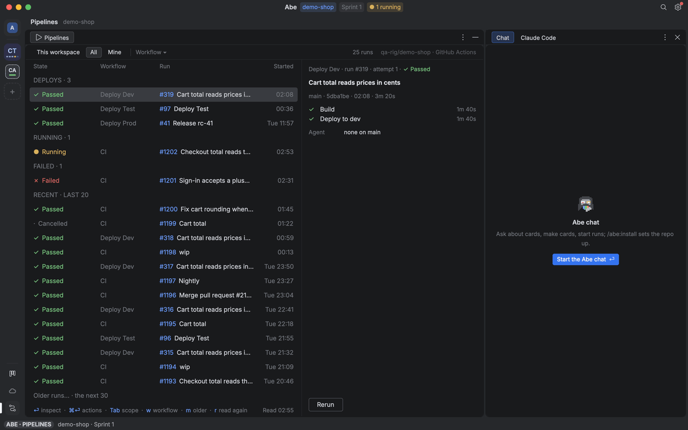

# Pipelines

The Pipelines tile in the window, then the `abe pipeline` commands behind it.

## Pipelines

**Pipelines**, the last place on the rail, fills the middle with the repo's runs (All, on any branch, a card's workspace too; its branch's, This workspace, one `⇧Tab` away, kept once picked), from GitHub Actions or, with the `pipelines` setting on `azure-pipelines` (Settings › Tools › Pipelines), Azure Pipelines in the `board` setting's organization and project; Linked's Pipelines row (⌃L) opens it on that run. Its overview groups runs Deploys · Needs approval · Running · Failed · Recent (the last 20), scoped This workspace · All · Mine with `Tab` / `⇧Tab`; **Deploys** is pinned on top: each workflow that deploys (a job with an `environment:` or a deploy command, or a name saying deploy and an environment; by hand ones too), dev → test → prod, with its newest run however old (branch, revision, who ran it), or Never run, a run there not repeated in another group (All and Mine show every deploy, This workspace those run on its branch), with the agent on each run's branch (the session working there) and the selected run's summary with its actions; `l` / `ö` move, `/` filters, `r` reads again, `w` (or the **Workflow** chip) picks one workflow's history, newest first. `⏎` inspects the run's job graph, drawn from the run's own revision (`needs` / Azure `dependsOn`; matrix legs and a reusable workflow's jobs framed under their key or caller; jobs in start order, said so, when the dependencies cannot be read; `k l ö ä` between boxes), `⏎` again the job's log with its steps and evidence (failure lines, artifacts with run, job, attempt and revision; `l` / `ö` walk them, `o` opens the file a test failure names at its line in the Editor); `Esc` steps back. `⌥⌘⏎` maximizes the list. `⌘⏎` is the run's menu: Inspect · Fix with agent… · Rerun failed · Rerun · Cancel run… · Open in browser (Approve… at a gate, asked with who acts; a production approval is the red yes with No the default; Cancel run… asks; rerun and cancel are GitHub's only). **Fix with agent…** says what goes where and asks before anything starts: a Claude Code session in your Local sandbox on the run's card, on the card's own branch when the run is on it, else on a fix branch `fix/<card>-run-<n>` from the failed revision (it asks which card); a card whose session is live gets the fix as a message, never a second session. `⏎` on an evidence row in the log sends the fix with that line or artifact. `abe pipeline list|show|inspect|log|rerun|cancel|approve|fix` are the same from a terminal.

**Settings** (Cmd+, or `:settings`, from every view) is WebStorm's Settings dialog, 1040 × 700 over everything: a tree on the left (Problems first while there are any, Appearance & Behavior, Keymap, Editor, Abe, Logins & tools, Skills, Version control, Tools) under `Search settings  /`, the page on the right. Each row is one line, its label and its input; the focused row shows dim under it its help, where a change of yours goes (`repo`, `yours` this Mac, `local` yours for this repo), where the value comes from (`built-in`, `Repo`, `Yours`, `fixed` with a lock) and its default. It shows as soon as the settings files are read; the login and tool checks fill Problems in a moment later without moving the page. `l` `ö` or ↑ ↓ move, `k` folds or goes back to the tree, `ä` / → unfolds or enters the page, `gg` `G`, Tab moves search → tree → page → Close. Each row is drawn with the input its setting's type takes: a checkbox (Space or Enter toggles), a dropdown for every closed choice, account and model (Enter opens it, typing filters, ↑ ↓ or Ctrl+N / Ctrl+P move, Enter picks, Esc closes; an account lists what this Mac knows, your gh logins and AWS profiles, with `none` first where none is a value, and a name typed that it lacks is offered as `Use “…”`), a segmented pick (Enter, `k` `ä`, Enter), a text or number field (Enter takes the caret; what it will not take is said under it as you type, and Enter never saves it), a list (Enter opens it in place: `l` `ö` move, Enter edits the item or on `+ Add` adds one, `a` adds, `x` or Backspace removes, Shift+↑ / Shift+↓ or `L` / `Ö` move it, Esc closes; its toolbar's + − ↑ ↓ for the mouse), rows of fields for View tweaks and Environments (Enter opens them: `l` `ö` between records and `+ Add`, `k` `ä` or Tab between fields, Enter edits a field or opens its dropdown, `a` adds a record, `x` or Backspace removes one, Esc closes; a click on a field edits it, ✕ removes, `+ Add` adds), a folder (Cmd+O or the folder button: the system's panel), a secret (dots, never its text), and Advanced JSON only for a key no input knows. Every change saves the moment it is made (`yours · saving…`, then `saved`); one it will not take says why under its row and saves nothing (a change that lowers the repo's value asks `Reason (required)` first); Backspace (or the row's Reset) resets yours to default at once; Cmd+Z (or Undo in the footer) writes back what the last save changed, one at a time; Esc or Close closes. `/` searches every page, its settings and the pages' names, results grouped by page; the tree greys the pages with no hit and ↑ ↓ there pass over them. A page picked while searching (a click, ↑ ↓, Enter on a page hit) shows all its rows, the hits marked; typing again shows the results. Esc clears the search (staying on a picked page), Esc again closes. Cmd+A selects a field's text: Backspace empties it, typing replaces it. Cmd+Enter proposes the row's value to the repo (a pull request on its `abe.yaml`). Nothing of the old Abe is imported. Abe's picks with no filter number their first nine rows (the digit picks one); a prompt scrolls sideways with long text, and one whose text goes to people (a PR comment, a review note) lists the repo's people after `@` (Enter or Tab puts `@login` in).

## `abe pipeline`

2.2 (the 1.0 Pipelines tab ported, ⌘7): one run shape over GitHub Actions and Azure Pipelines (`core/src/board/pipelines.ts`, a value module `ui` imports as `@abe/core/pipelines`; the graph from the run's own revision's workflow `core/src/board/pipeline-graph.ts`: `needs` / `dependsOn`, matrix legs and reusable workflows grouped, `partial` when some links cannot be read, no edges at all when nothing is trustworthy, never inferred from times). The `pipelines` setting (`github-actions` default, `azure-pipelines`) in force in the checkout picks the provider: GitHub's repo is the checkout's `origin` as its config writes it (`git config remote.origin.url`, never an `insteadOf` rewrite), Azure's the `board` setting's organization and project; `prodEnvironments` adds environments that are prod besides the names `prod`, `production`, `prd`, `live` (a lower Layer only adds). Commands (`serve/src/board/pipelines.ts`), each with `--repo <checkout>` (default where abe runs): `pipeline list` (the latest 30 runs, `--workflow` one workflow's (GitHub's `actions/workflows/<file>/runs`, Azure's definition by name), `--page` a later page of `--limit`; the workflow catalog, your login), `show <run>` (its stages: GitHub's jobs, Azure's timeline stages; a waiting stage's gate, GitHub's pending deployment matched to its job only when one job waits for one environment, else each environment a stage of its own), `inspect <run> [--attempt]` (the attempt's jobs, steps, graph and artifacts: an artifact's job only when exactly one job's log names its upload URL, `Artifact download URL: …`), `log <run> --job`, `rerun <run> --attempt [--failed]`, `cancel <run> --attempt` (risky), `approve <run> --environment [--yes]` (risky; a prod environment's refused `prod-needs-yes` without `--yes`; not yours `not-yours`, none waiting `no-gate`), `fix <run> [--card] [--job] [--evidence] [--artifact…] [--message]`. A write reads the run first: another attempt than the one named is `attempt-changed`, a rerun of one still going `still-running`, a write sent before or whose answer was lost (read again, not seen to happen) `uncertain`, never sent twice. Run controls are GitHub's only (`unsupported` on Azure). `workflows [--ref]` lists the workflows a person may run by hand (`on: workflow_dispatch` in their files at the ref, `dispatchInputsOf`) with each input's name, description, type, default and a choice's options; `run <workflow> [--ref] [--input k=v…]` runs one as you (`gh workflow run <file> --ref … -f k=v`, the ref the checkout's branch when not named, a workflow without `workflow_dispatch` refused `not-dispatchable`) and answers its run once GitHub lists it (its newest manual run on the ref made since, looked for a few times a second apart; null when not yet). Both GitHub Actions only for now (Azure: none to run, `unsupported`). **Fix with agent** (`pipeline fix`, ADR 0020): the failed run to a Claude Code session in the Local sandbox on its card, the card the one whose `card/<n>-…` branch the run is on, else `--card` (refused `no-card`); a live session on the card gets the fix as a message (`session send`'s path), else `session launch`'s path starts one (`placement` with `local-sandbox`) on the card's own branch when the run is on it, else on `fix/<card>-run-<n>` (`fixBranch`) made from the failed revision (`LaunchExtras.from` → the runner's `from` → `worktrees.onBranch`'s first ref that is a commit); its launch prompt is `fixPrompt`: what failed where, the run, attempt, revision, the jobs' logs, the evidence and the usable artifacts. Tests: `core/src/board/pipelines.test.ts`, `pipeline-graph.test.ts`, the adapters on a fake `gh` and a local Azure DevOps (`ports/src/github/pipelines.test.ts`), the CLI seam with a fake `claude` (`serve/src/board/pipelines.test.ts`), the screen (`ui/src/pipelines/pipelines.test.ts`, `@abe/testing`'s world `testing/src/screens/pipelines.ts`, its contract trees `pipelines-*.json`).
