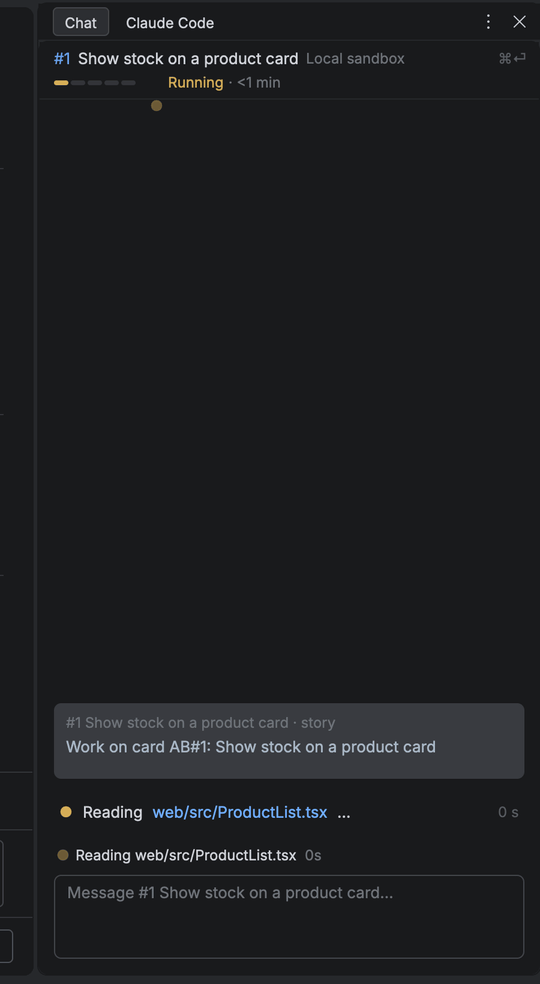

# Chat's screens

Chat, its cards and composer, Attach, PR review, Sheets and the Settings dialog, as `abe ui bridge` draws them ([the bridge](ui-bridge.md)).

- **Chat**, DS 2.0 ChatView, App Map OPT-A2-TwoBandsChat; 2.1): the window's Chat column (the `chat` slot's `chat` screen, `ui/src/chat/pinned.ts`) beside the Board too; the factory screen draws no Chat of its own. It sends the `selected` shell effect (whole-state, sent only when it changed), `{card: number | null, owner: string | null, title?: string, session?: string}`: the app opens `chat {card, whose?, title?}` (`pin: <session>` too while `session` names one: a prototype session's chat; an open without it lets go of it) in the `chat` slot while the Factory view is shown, at once in Chat mode, the Board's tree waiting up to 120 ms (`CHAT_SYNC`) for Chat's answer so the ring and Chat's header and body change in one frame, once the selection rested 300 ms in Terminal mode (each card attaches its session); not sent before the cards are read; no card (the ring on an empty column) opens `chat {card: none}`: header `Chat`, `No card selected`, nothing acted on; `title` is the card's title as the Board has it, the no-session header's name before `card show` answers (a late `card show` for a card left is dropped); `owner` is the assignee's name on a teammate's Team card (Chat read-only; none while Mine is read again). With no `owner` Chat decides whose the story is itself (`whoseOf`: not in its `card list --mine` and assigned); a `card assign` (`command.ran`) reads Mine (`mine@<seq>`, an older Mine read's answer dropped) and the card again, yours meanwhile, so a card just assigned to you is never read-only. What opened the factory's own Chat (the launch's answer, Linked's Sessions row, Reopen, the landing) opens `chat {card, session?}` in `chat` plus `focus {slot: chat}`. The column's header and ⌘2 show and hide it (no toolbar Chat button). State and keys in `ui/src/chat/pinned.ts`, the rendered Chat in `ui/src/chat/rendered.ts` (the header, the session's transcript as turns); Claude Code's TUI shows only in the column's Terminal mode: the `chat` screen opened with `mode: terminal` draws the pinned session attached (a Terminal keyed `attach:<session>:<run>`), in the Factory view and the Editor as the column itself (3.0: the column is the AI chat only, shells are the bottom pane's Terminal). The **Terminal** component `{key, argv, cwd?, env?, focused?, screenKeys?, links?}` (`ui/src/chat/terminal.ts`, Rust `app/src/factory/{terminal,chat}.rs`) stays for Terminal mode: the shell keeps one PTY per key, started when a tree first holds it, kept while trees do, dropped 10 minutes after the last one did (`TERMINAL_KEEP_MS`) or on the `drop-terminal` effect; every key goes to the program except `screenKeys` and ⌘ keys, and its exit comes back as an `exit` frame. 2.0's terminal-era Chat (`abe session attach` in the Factory screen's tree) is gone.
- **The rendered Chat's components** (2.1, slice t113c; boards R-Anatomy, R-Turn, R-Working): `ui/src/chat/chat-components.ts` (Transcript newest at the bottom: the shell keeps its scroll, sticks to the bottom while there and says `<id>:up` / `<id>:bottom` as clicks; `reveal` a part's id, `bottom` a counter to jump down; a trailing NewBelow pinned under it; Turn (parts 8 px apart, step rows abut), ChatMessage, ChangesBar (`kept`), DiffCard (lines, `folded`, `more`, `selected`; `diffCard` cuts at 12 lines), StepRow (✓ ✗ ●, `unfolded` output; `stepRow` keeps 10 lines), StepsFold, Prose, StageDivider, NewBelow, QueuedMessage) and ChatHeader's 2.1 look (`story`, `modes` with ◆, `box`, `rail`, `override`; `terminal.ts`); Rust `app/src/factory/{transcript,diff_card,chat}.rs` (the diff coloured by a small JS / TS lexer with the DS syntax tokens; prose through the card dialog's markdown renderer). Fixtures `contract/trees/chat-turn*.json` (`@abe/testing` `CHAT_TURN`, `CHAT_TURN_GALLERY`). No screen builds them yet: the transcript model does (t113d).
- **Attach**; ⌃W since 2.1): `abe workspace attach-spec <session> --json` (`core/src/session/attach.ts`) answers what VimStorm runs to open the session's workspace, `{where, root, nvim, shell, exec, box, waking}`: local, the worktree with plain argv (`nvim --embed`, the login shell, no exec prefix), opened as a plain project; cloud, each through `abe box attach <box> -- …` to the Workspace's own box, which runs it on the box's host, then `docker exec -i [-t] -u abe [-w /workspace/repo] abe-workspace …` into its workspace container (`inWorkspace`; Download locally / Move to cloud's copy goes the same way), Neovim as `NVIM_APPNAME=vimstorm nvim --embed` there (the base image's Neovim and VimStorm config), `box` its name and region (serve's `AWS_REGION`), `waking` while the local machine does not know it to run (a queued session is refused `session-queued`; one that never got a box, `SessionData.neverPlaced`, is refused `session-never-placed`, as `session download` refuses it). `$ABE_BOX_ATTACH` names a fake `abe box attach` in tests (`testing/src/tools/box-attach.ts`); `abe session attach` on a cloud session uses the same. The screen sends `open-project` with `attach` (`nvim`, `shell`, `exec`, `box`, `waking`); the shell (`app/src/remote.rs`) starts the Editor's Neovim from `nvim`, terminal tabs from `shell`, and runs git and the Project tree's listings after `exec`, one seam each (`exec` is `abe box attach <box> --shared -- …`, a round trip on the box's shared SSH connection; the tree's first walk lists every folder up to its 2000-folder limit in one call, and every call to the box runs on a thread of its own, never GPUI's executor); RemoteState in the editor slot while connecting or after a failed connect (Retry ⏎, Download locally ⌘⏎: the attach's `download` click, `download:<session>`, which the screen runs as `abe session download <session> --repo <root>` and answers by opening the copy as a plain project), `☁ your environment` in the status bar.
- **Chat's cards** (2.1, slice t114b; boards R-Question, C-Question, C-Answered, C-Permission, C-NeedsYou, C-Override, C-Grill, C-States, R-Anatomy): `ui/src/chat/cards.ts`. Components QuestionCard (`ask` question · grill · permission · needs-you; rows 1–9 with `recommended`, a grey row's `reason`, a multiSelect question's box per row (`multi`, each `ticked`; Space or a digit ticks, ⏎ sends), `o` own words and its field while `typing`, `stack` `2 of 3` and the edges `under` it, `expired`, a teammate's `whose`, a grill question's `brief`), CardLine (an answered card folded to `◆ Answered · <label> (<n>)`, a grill's boxed `◆ Q1 · …`), GrillRound (header, progress dots, its cards, one send), OverrideCard (the reason field, required; Reach, Until; serve's refusal under it) and DeferredPill (`◆ N for later · …` above the composer). The model is pure: `cardsRead` (`session asks`), `cardsEvent` (`session.ask` / `session.answered`), `cardsRun` (a run's Needs you, only for its own reason: not its session's, not its pull request's), `cardsKey` (1–9, ⏎, y, Tab / ⇧Tab, o, l / ö, Esc; `handled` false when no card is up or the session is a teammate's), `cardsText`, `cardsClick` (`card:<id>:<n>`, `card:<id>:own`, `card:<id>:line`, `cards:pill`), `cardsReopen`, `cardsResult` (a refusal unfolds the card), `openOverride`, `overrideLine` (ChatHeader's ✎ row), and the nodes `cardNode` / `pillNode` / `foldedNodes`. Answers run `session answer` (a grill round `--answers` as one numbered message), a Needs you's `session send` (`continue`) or `session stop` (asked). serve holds a session's queue while a question card is open and types the answer and the queue as one prompt (`queue.answer`). Rust `app/src/factory/cards.rs`; fixtures `contract/trees/cards-*.json` (`@abe/testing` `CARD_TREES`, `CARDS_GALLERY`). The `chat` screen holds one per pinned session (`ui/src/chat/chat-cards.ts`): `session asks` read on pinning, the events followed, the keys to an open card before the transcript's and the composer's (Esc too), the open card after the last turn, the answered lines placed by time, the pill at the top of the column's foot; the header's ✎ row from the session's `overrides`; `:override <what>` is a `choice` the bridge routes to the Chat slot (`slot` on the choice command), the composer's `/override` calls `chatCardsOverride`; the status bar's `◆ needs you` sends the `cards` / `reopen` choice.
- **Chat's composer** (2.1, slice t115b; boards R-Composer, C-Context, R-Anatomy, R-Working): `ui/src/chat/composer.ts`. Components Composer (the field: its `text` and `caret` (`ui/src/runtime/field.ts`: absent at the end), `placeholder`, `focused`, the dim `model` line `opus · medium` (a click picks another), or an ended session's `line`; children: the ContextChip, a SlashMenu while one is open), ContextChip (`@api/src/cart.ts#L12-18 · selected`, `@…:16 · caret line`, `#2 … · selected card`, `⌫ drop`; `dropped`) and SlashMenu (`items` of `cmd` · `desc`, a grey item's `reason`, `selected`); queued messages are t113c's QueuedMessage rows (× `composer:unqueue:<n>`). The model is pure: a draft per session, the caret's context (`composerCaret`: the app's `caret`; null: no file open) or the Factory view's card, the queue and model line from `session show` and `session.queued` / `session.model` (`composerSession`, `composerEvent`); `composerKey` (a printable key gives the field the keys and types; ⏎ sends `session send <id> <text> [--context <json>]`, ⇧⏎ a line, ⌫ in the empty field drops the chip for one message, `/` first opens the menu: the commands, then the session's skills (`abe session skills <id>`, asked once per session as its field first starts with `/`: core `session/slash-skills.ts` names them, serve `session/skills.ts` reads each `SKILL.md`'s `name`, `description` and `user-invocable: false` — the plugin's as its launch builds it (`pluginSkillFiles`: core's, the Abe chat's `CORE_HUB_SKILLS` there, the repo's `abe/skills` copies but `CORE_ONLY_SKILLS`) as `/abe:<name>`, the worktree's `.claude/skills` as `/<name>`, the sessions' `HOME` `.claude/skills` only with the session's `skillsOnTop`, yours winning a name; a box's session its box's serve answers), each row `Abe’s · `, `Repo’s · ` or `Yours · ` before its description, at most `MENU_ROWS` (10) shown around the selected one: typing filters (a command by its start, a skill by its name's start, then the part after `abe:`, then anywhere in it), every letter types (`/cl`), ↑ ↓ ⌃P ⌃N move, ⏎ runs a command and puts a skill in the field with a space (Tab too), Esc shuts it leaving `/`, a second Esc clears; Esc in the field gives the keys back, `handled` false), `composerText` (⌘V, a dead key's or an IME's text), `composerClick`, `composerResult`. Routing: `/override <what>` hands `override` to the screen (t114b's Override card), `/compact` and any other `/word` go to Claude Code as typed (never with context), `/clear` is asked `y` first, `/model` (or the line's click) opens the model pick (`settings get allowedModels` × low · medium · high, the current one selected, typing filters) whose ⏎ runs `session model`, `/improve` is grey for now. `composerDock` is the column's bottom: the queued rows over the composer. Rust `app/src/factory/composer.rs` (the field wraps, grows from 2 to 8 rows of 20 px, then shows its last rows; while it has its slot's keys it is the window's input handler, so a dead key composes and its text goes as `text`); fixtures `contract/trees/composer-*.json` (`@abe/testing` `COMPOSER_TREES`, `COMPOSER_GALLERY`). The `chat` screen does not hold it yet (the wiring follows t113d).
- **PR review** (Git Log, RULES 11, ported from 1.x's Rust `changes/*`): the `review` slot's `review` screen (`ui/src/review/review.ts`, the files pane's rules `review-model.ts`, asks `review-asks.ts`) holds every PR under review (keyed by checkout and number); the app opens it with `{pr, path, list: heat | folder, unchecked?}` (or `{pick: <root>}` for the Log's `PR ⌄` pick) and draws its `ReviewPane` tree (strip, the files pane's lines, the drafts and threads the diff's gutter and cards show, the right-click menu, the Log's lifecycle rows). Inputs: keys, and `{kind: 'review', ask}` (comment, reply, resolve, edit, delete, verdict, next, at, scope, rescope, step, order, mark, menu, lifecycle, pick). Effects: `show-diff` (VimStorm's diff viewer on the scope's base..head at a line), `review-said` (a balloon in the diff), `pr-pick` (the chip's rows), `review-open` (the picked PR checked out: open it). Rules `core/src/review` (hunks, the prepass, marks by content hash and since your review, drafts, the one review per submission with its marker, refused when the head moved); IO `ports/src/git/review-git.ts` (a PR range's files, commits and packages, the review worktree `<main>-pr-<n>`, `refs/pull/<n>/head`; the main checkout's local-only files it gets are kept out of git in Abe's card block of `info/exclude`, which the last of Abe's worktrees removed takes out) and `review-github.ts` (`gh`: the PR, its threads, the review, comments, replies, resolve, ready, close, the draft PR); the drafts and marks docs are 1.x's `<main>/.scratch/abe/{drafts,marks}/<pr>.json`, byte for byte. Heat is size order: 1.x's ranking one-shot is gone. Merge stays `abe pr merge` behind its confirm. Every GitHub write here (the review, a comment posted now, a reply, resolve, ready, close, the draft PR, `abe pr merge` too) goes only as the `githubIdentity` setting's login, gh's login read first (`core/src/review/identity.ts`): another one, or none read, refuses it in red naming both; unset, gh's login goes.
- **The rendered Chat** (2.1, slice t113d; boards R-Turn, R-Working, R-Anatomy, H-States B rows): `ui/src/chat/transcript.ts` turns a session's entries (`session transcript`, then its `session.transcript` events put at their numbers; `watch.gap` reads on with `--since`, `serve.started` reads again from 0) into turns and the tree: your message (its context chip), the changes bar (`N files changed · +a −r`, Open all · Keep · Revert, from serve's `changes` entry), one DiffCard per file (keyed by path; the newest turn's first open, 12 lines then `show N more`), the step rows (core's verb table `@abe/core/steps`, the one value module ui may import; older turns fold to `N steps`; a call with no result runs only in the newest turn of a live session, else `stopped`), the prose; stage dividers and other parts' nodes (`placed` by time, `tail` after the last turn) between them. `ui/src/chat/rendered.ts` holds a session's read, cursor, folds and scroll and draws header B over the transcript, then the `foot` (`renderedView(r, facts, slots)`: the cards and composer go in there). Keys: `l ö` (and arrows) the parts, `gg G`, ⏎ (a diff card: `open-file` at its first change; a step: its output; `N steps`; `show N more`; `↓ N new`), `u` (a diff card's file, the bar's turn: asked, then `session revert`), ⌘⏎ the session's menu. Scrolled up (the shell's `<transcript>:up` click), new entries leave it and `↓ N new` counts them. States: reading, unreadable (`Transcript not readable here · ⌘4 Terminal mode`), ended, a teammate's (`whose`: read-only, no Stop). The `open-file {path, line}` shell effect shows the Editor of the open workspace holding the file (else its git root's, opened) at the line (`app/src/workspace/projects.rs`).
- **Sheets in the shell**, App Map V2-13 … V2-15, DS 2.0 BrowserView, Sheet): **BrowserView** `{key, url, mode: sheet | app | open, title, sub?, address?, version?, badges?, action?, focused?}` (`ui/src/runtime/browser.ts`) is a native WKWebView the shell places in the node's slot under its bar (title, address ` · v<n>`, badges joined `·`, the action's keys): one web view per `key`, kept across trees. In `sheet` mode the shell (Rust `app/src/browser`) blocks every request and navigation but `url` itself (a WKContentRuleList and a navigation-policy delegate, beside the page's own CSP: `form action`, `meta refresh` and top-level navigations are outside the CSP); `app` mode (a prototype's proxy) everything but `url`'s origin; `open` mode (ADR 0041, a prototype's app on its fixed ports) is a browser: no rule list, any http(s) navigation, its cookies on disk per origin, a popup in the same page. Keys go to the page only while `focused`; Esc in the page gives them back to the screen. The page's doings come back as the app's `browser` frame `{key, event}`, event `loaded` {url} · `blocked` {url, what} · `focus` {focused} · `failed` {message}, the screen's `browser` input. Opening one (`ui/src/board/sheet.ts`, state in `factory.ts`): `:show <name>` (a word that takes text, `Word.takes`: `:show cart` runs it, `:show` alone asks the name) runs `sheet find <words…> --card --session` with Chat's card (else the selected one) and its session, and opens the best with `sheet open`; no match says `No Sheet matches “…”`. A Terminal has `links` (`{pattern, click}`: ⌘-click on a matching row sends `click` with `$1` its first group); a `show:<title>` click opens that title exactly first. The tab is shown in the Board's place (Chat stays) and is modal: Esc back to the Board, ⏎ the page gets the keys, ⌘⏎ its Action menu (Attach to card: `sheet attach <id> --card <n>`, the Sheet's card, else the current one, else asked; grey on a card's Sheet; Back to the Board). Badges `yours · sandboxed · no network`, `attached` once `sheet.attached` names it; a blocked request is said on the status line. The card dialog's **Sheets** (`CardDialog.sheets`, beside its sections): `loading` until `card show <id>` answers, then its attached Sheets, the newest attach first (a `dialog` command with `update`: the open dialog keeps its scroll and cursor); Tab past its buttons moves the keys into its rows, `l ö` there, ⏎ (or a click) shows it (`sheet open <card>/<id>`), Esc back to the body, Tab on to the first button. The card dialog's buttons take the keys as a confirm's do (`buttonStep`): ← → (`k ä`) and Tab ⇧Tab move between the ones not grey, drawn as the default (`CardDialog.focus`), ⏎ presses it.
- **The Settings dialog** (2.1; boards T-Appearance, T-Agents, S-Search, S-Problems): `ui/src/settings/settings.ts` (the step; its parts per page in `ui/src/settings-*.ts`: `state` with its one `Mode` of edit / propose / remove / add, `tree`, `rows`, `change`, `list`, `records`, `logins`, `import`, `colours`, `profiles`, `propose`, `writes`, `keys`, `view`) is a second `LayerScreen` the bridge mounts once beside Command mode (`settingsLayer(settingsDialogRules(parseYaml))`: `ui` takes core's catalogue and rules handed in, `core/src/layer/settings/dialog.ts`). The `layer` frame carries the top of the two: Command mode's while it is up, else the dialog; a person's input goes to that top layer. The app's ⌘, sends `open {screen: "settings", params: {page?, row?}}` and `:settings` is a Command-mode word (`SETTINGS_WORD`) whose `open` the bridge routes to the dialog the same way, so it opens over every view (Rust centres it 1040 × 700 over the whole window, deferred above every overlay but popups: `app/src/factory/settings.rs`). It ignores `blur` (modal); its own popups (the combo's list, ⌘⏎'s propose popup, S6's fix strip) are inside its tree. Each open runs `abe settings list --files-only` and `abe settings problems --files-only` (the settings in force alone, from serve's snapshot: answered at once, no GitHub, login, tool or Docker check), then the full `settings list` and `settings problems` (the open proposals and gh accounts; the checks, which take seconds); the page shows on the files-only answers, landing on Problems while there are any and you have not moved, and a full answer landing later never moves it (an older answer landing after a newer one is dropped); `settings.changed` reads the rows again, `serve.started` after a failure reads them all. Components (`ui/src/settings/settings-components.ts`, `SETTINGS_KINDS`): SettingsDialog {title, search, note, focus, selectAll, undo} › SettingsTree {nodes} · SettingsPage {crumbs, scope, reveal} › SettingsGroup {caption} › SettingRow {label, control, help, source {text, tone, lock}, scope, default, reset, hint, focused, hit, changed, error, reason} · ProblemRow · SettingsNote · SettingsEmpty {title, line, action} · SettingsPropose {title, to, label, value {kind, from, to}, reason, focus, error, busy, where}. A row's `control` is a kind (`checkbox`, `combo` with its `open` list, `segmented`, `field`, `list`, `path`, `secret`, `records`, `advanced`, `value`); the catalogue's schema-fit input decides it (`core/src/layer/settings/input.ts`): every closed choice is a combo or segmented pick, an account a combo of what serve knows (`ChoiceSource`: your gh logins, your AWS config's profiles and regions, the repo's environments, a Layer's Azure DevOps organizations, the browser profiles; `free`: a name typed into its filter is offered as `Use “…”`, `clearable`: `none · <what none means>` first), `views` and `environments` a `records` editor (`core/src/layer/settings/records.ts`: rows of fields, typed or picked, a record lacking a field said in plain words), Advanced JSON only for a key no editor knows; a row is one line, label and control, its help, scope, source, default and Reset dim beneath while focused; a later page adds a control kind or a page part (a theme cell, a token row, a key row, a widget row, the reach table) to this set and a draw arm in `settings.rs`, never a new dialog. Search: `/` matches settings and the pages' own names (`pagesCorpus`: a page hit is a result row whose ⏎ opens it); the tree greys pages without hits and ↑ ↓ walk only the lit ones; a page picked while searching (click, ↑ ↓, ⏎ / → in the tree, ⏎ on a page hit: `picked`) shows its rows with `hit` on the matches until the search's text changes; Esc keeps a picked page. Tab cycles search → tree → page → Close. ⌘A (`all`, the dialog's `selectAll`) selects the text of the field with the caret (search, a field, a reason, a colour, the propose popup's; not a combo's filter nor Add profile's cells), let go when the caret moves to another field; ⌫ or a typed key / pasted text replaces it, any other key lets it go. Click ids: `settings:tree:<node>`, `settings:line:<n>`, `settings:choice:<n>`, `settings:cell:<row>:<col>`, `settings:record-remove:<row>`, `settings:record-add`, `settings:close|undo|search|retry`, `settings:propose:open|cancel|value|reason|to:<team|repo>`. A change saves the moment it is made (`settings-writes.ts`): ⏎ / Space / a pick / a list's or records' edit runs `abe settings set <key> <value>` into your Layer at once (`--override --reason` when core's guard says the change lowers an upper value, the reason asked in place first; a field of an object key first reads yours with `settings explain` and writes the whole object; ⌫ / Reset runs `settings unset`); the row shows its change (`yours · saving…`, `saved`) until the rows read after the write show it; a value the CLI's reading refuses says why under the row and nothing is written, a write refused takes its change back and says why there too; ⌘Z (the footer's Undo) writes back what the last save changed (yours as it was, or `settings unset` when yours had none), one at a time; ⌘S with a field open takes it as ⏎; Esc or Close closes, nothing to ask; ⌘⏎ on a row (S3, board S-Propose) asks core's `rowOffer` (the CLI's own rule) and opens the propose popup on the value it would propose (a checkbox the other one, a combo its choices on ↑ ↓, else a field), the reason required; ⏎ runs `abe settings propose <key>[#field] <value> --reason <why>` (a pull request on the repo's `abe.yaml`), its answer closes the popup, says `Pull request #N open for repo <repo>: …` and reads the rows again (the row's `PR #N open`, `PRs #1, #2 open`); a refusal stays in the popup. A proposal is never a change of yours. A theme, density or font picked, and Colours' changed tokens, are live at once: after each step `lookDue` sends the `look` command when the changed look moved (`null` once the rows read it back, or at close). Appearance (S4, T-Appearance): `ui.theme` draws as the `themes` control (a preview cell per theme from `abe theme list`, ⏎ k ä ⏎ picks; the cells name their source, so the row has no help and no source line but a staged pick's); Editor › Color scheme (T-Colours): `editor.scheme` is a combo (`Same as theme (<the theme>)`, then every theme by name), and the Colours row becomes Reset colours (⏎ saves every token back at the base theme's colour), a Filter row and one row per token (`colour` control: swatch, hex) under each group's caption and count, from `abe theme show <in force>` (a named scheme's theme, its editor, git, diff and terminal groups only, its save setting `editor.scheme`); ⏎ on a token is a colour field (each valid hex live), its ⏎ (or ⌫'s reset) saves at once with `abe theme save <theme> --tokens …` then `settings set ui.theme <saved>`; ⌘Z saves the tokens as they were. Logins & tools (S6, board S-Logins): its rows are core's `checkItems` (`core/src/layer/settings/logins-tools.ts`) over `abe login status` and `abe tools check`, read once per open when the page shows, each a **CheckRow** ending in `✓ OK` or `fix… ⏎` (every row drawn at once as `checking…` and filled in place as its read lands, a refused read's rows saying `⚠ can't check: …`, a login's value who it works as; az's not signed in its folder, as `abe login status` says it, `loginNote`); ⏎ (there or on a Problems row's fix) types the command into the **SettingsFix** strip under the page (`queued · ⏎ runs it`), ⏎ again starts it as the strip's Terminal (`/bin/zsh -lc <fix>`, focused: the shell gives a layer's focused Terminal the keyboard, Esc stays the dialog's); its `exit` (the bridge feeds `exit` to the Settings layer too) reads the checks and Problems again; Esc drops the strip and its terminal. Browser profiles (board S-Profiles): the page reads `abe browser list` once per open (again on `browser.profile` and after an Open's answer) and draws its `browser.profiles` row as a `Table` (Name · Purpose · Sign-ins: `open now`, `stored 3 hours ago` or `not stored`, a failed store on its own after it · Default ● · an Open button, then `Add profile…`; the group gives a Table its height), one line per profile: ⏎ or the row's Open (a cell's own click id, `settings:open:<n>`; `TableCell.id`) runs `browser open <name> --front`, Space runs `browser default <name>` (the built-in's `none`), r on yours renames it in its row (the new name, ⏎: `browser rename`), ⌫ on yours asks `Remove <name> from your Layer?  y / n` then `browser remove`, Add profile… takes a name then a purpose in place for `browser add <name> --purpose …`, ⌘⏎ on yours opens the propose popup with the repo's list and yours added (a `fixed` value) for `settings propose browser.profiles`. A write's answer carries the list after it. Import config (page `import-config` under Appearance & Behavior): VS Code · WebStorm · Vim / Neovim; ⏎ on one runs `abe settings import <src> --dry-run` and lists its rows (a checkbox each, ticked for a match, a fixed one for `no match here`, the setting it becomes as the source line); the source's value counts only settings (`11 of 56 settings match`: the Feel's row and key bindings are none, the keys' own count in the group's note, `2 of 5 keys match a Keymap action`), `not read` before; Space ticks, `Import N settings · M keys` (one per setting written, one per key) runs `settings import <src> --only <keys>` (`key:⌘Y` for a binding); only your Layer and your keys.json are written. No `abe` (or serve down): the tree and `abe serve not answering · Settings read when it is back` with Retry; Rust draws the contract's `trees/settings-serve-down.json` itself when no bridge runs.
