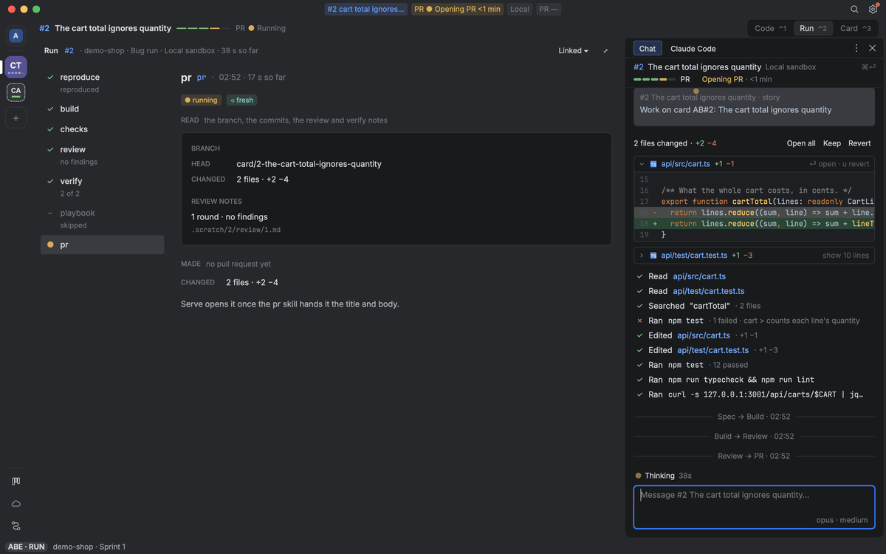
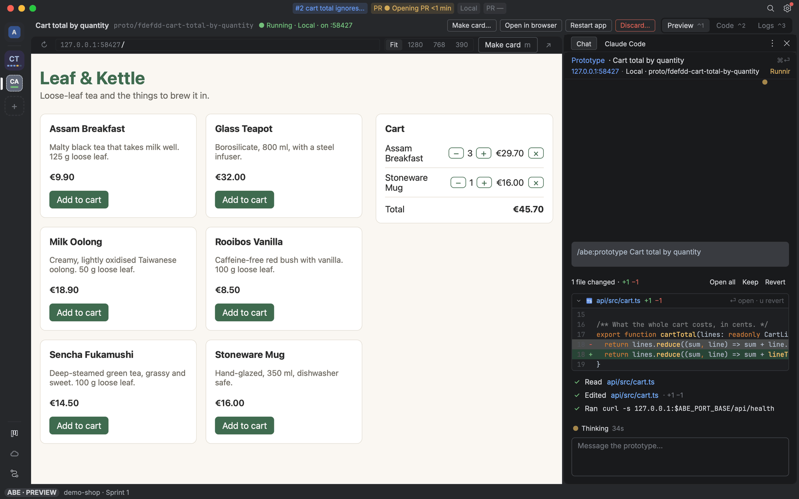

# Verify and prototypes

The browser a verify step drives, its profiles, and prototypes.

## Verification's browser

ADR 0016. `abe browser start | stop | status` from inside the workspace (answered on its socket, like `status`): the box's `serve` runs one headless Chromium in the workspace container through the Browser port (`core/src/ports/ports.ts`; `ports/src/mac/browser.ts` runs its start / probe / stop scripts with `docker exec`). Rules in `core/src/browser/browser.ts`: DevTools on `127.0.0.1:9222` in the container's own network namespace, its profile `~/.cache/abe/browser/profile` made anew each start, the sandbox kept (the workspace's seccomp profile, never `--no-sandbox`). A second `start` answers the running one. It stops on `abe browser stop`, on verification's end (`BrowserService.stop('verified')`, for the verify command), on its own (`exited`), or after 10 minutes with no DevTools activity: `serve` reads the open pages (id, URL, title) and the connected clients every minute, and any change is activity. `browser.started` / `browser.stopped` (with the reason) go to `abe watch`. The session gets chrome-devtools-mcp from `/run/abe/mcp.json` (`<state>/workspace/mcp.json` on the box, `browserMcpConfig`), which its launch passes to `claude --mcp-config`: it attaches with `--browserUrl` on its first tool call, again after a restart, and writes files (screenshots) only under `/workspace`. Tests: `fakeBrowser()` behind the port, and the adapter's scripts against a fake Chromium process (`fakeChromiumArgv()`).

### Browser profiles

#103. A verify step's browser may start signed in: a profile is `{name, purpose}` in a Layer's `browser.profiles` (the repo's shared ones, then yours; a name given above is the same profile, the upper purpose wins), `browser.default` names the one a run uses when it names none; unset, the built-in `default` is 2.0's empty profile. Rules in `core/src/browser/browser-profiles.ts` (name rule, merge, the list, the 1.0 migration plan), commands in `serve/src/browser/browser-profiles.ts`: `abe browser list` (the repo's first, then yours, `default` last; each with its Layer, when stored, whether its Chrome folder is on this machine; folders no Layer names as `Not in a Layer`), `add <name> --purpose`, `rename`, `remove [--forget]`, `default <name|none>`, all writing yours, never the repo's file. Locally a profile's Chrome folder is `<config>/chrome/<name>`; the first `abe browser` read renames 1.0's pair `<x>` / `<x>-admin` to `work` / `work-admin` (never while a Chrome runs on them), leaves links under the old names and puts both in your Layer with `work` as default. Sign-ins travel as a DevTools storage state (cookies + local storage), never the folder (`.scratch/2.1/t103/report.md`): `abe browser open <name> [url…] [--front]` (the local machine) starts that profile's visible Chrome on its folder (`ports/src/mac/chrome.ts`, 1.0's rules: `--user-data-dir`, a debugging port Chrome picks in `DevToolsActivePort`; no temporary folder, no incognito, nothing ever wipes it, so its sign-ins stay there across quits) to sign in once (`--front`: in front of the window in front; one open on the folder with no URLs named is brought to the front, its tab activated through DevTools' `/json/activate`, a new window where it has none, never a second Chrome); `abe browser store <name>` reads its every cookie and the local storage of the cookies' and open tabs' origins through DevTools (`ports/src/mac/browser-devtools.ts`; refused `chrome-not-running` naming `open`, above 60 KB `profile-too-large` naming the biggest origins) and writes it, `{v:1, storedAt, cookies, origins}` (`core/src/browser/browser-state.ts`), as one secret of yours `abe/<person>/browser/<name>` (`ports/src/aws/browser-store.ts`: `<person>` is your logins secret's, `$ABE_LOGINS_SECRET` on a box, else the `abe/<person>/logins` secret tagged `abe:owner=<GitHub login>`; a first write creates it with `alias/abe-logins`, the logins' `abe:owner` / `abe:team` tags, `project=abe` and the logins' resource policy before any value; the value only on stdin, never argv, a reply, an event or a log; `$ABE_LOGINS_STORE=file://<dir>` a folder in its place). `rename` moves the stored copy, `remove --forget` deletes it; `list` says when each was stored (and how long ago), whether its Chrome is open now and why a store on its own last failed. A Chrome `open` started, or `list` found open on a profile's folder, is watched by the Mac's `serve` (`serve/src/browser/profile-watch.ts`, every 5 s) and stored on its own, as `store` does: Chrome cannot be read once it has quit, so while it runs its cookies are read, alone: never a tab (local storage takes a setup tab per origin, and the pages those load set new cookies, so reading it on each sign-in opened tabs without end); local storage is stored only by `abe browser store`. A sign-in (a cookie name new since the last store, holding still for two readings) is stored at once; on its close the cookies as last read are stored, unless that is what was stored. A store that fails touches nothing local (the folder keeps everything) and is said on the row; no store set up for you (`no-person`) is skipped quietly, and with no store reached nothing is read. Event `browser.profile` (`open`, `closed`, `stored`, `store-failed`), never a value. A run names its profile: `abe factory run --profile` / `abe session launch --profile` (default `browser.default`; a profile no Layer has is `no-profile`, one with nothing stored `profile-not-stored: abe browser store <name> locally`, both before anything launches) keep it on the session (`SessionData.browserProfile`; to a box as `session run --profile`). `abe browser start [--profile]` in that session starts in it: the box's serve reads the secret (`profile-unreadable` naming it, never its value), starts the fresh Chromium as ever, then sets the cookies into its default context and each origin's local storage through a setup tab whose request DevTools answers itself, all before it answers (reached through `docker exec -i <container> socat` behind a local listener; a failed restore stops it, `profile-restore-failed`). While the run is in verify, `--profile` naming another is refused `profile-differs-from-before`; outside verify a step may start another. The kept verify reports get a `Browser profile: <name>` line under their title; `abe browser status` names the profile and how old its copy is. A local Factory run's own browser (below) restores a profile the same way, through its local DevTools port.

## Prototypes

ADR 0018, 3.3, ADR 0039. A prototype is a session where cards run, building throwaway code to answer a design question, with the app run from it behind the prototype proxy, or, for a repo whose app takes fixed ports, the normal way on them. Rules in `core/src/prototype/prototype.ts` (ids, the default branch, the start script's answer, the proxy's routing) and `code-prototype.ts` (the session, its worktree and branch, the upload), handlers in `serve/src/prototype/prototypes.ts` (the app and proxy) and `code-prototype.ts` (the session), kept in `<state>/prototypes/<id>/`.

- **Starting one** is the Abe chat's: `/abe:prototype <idea>` (core's `prototype` skill) runs `prototype start <words…> [--card <id>] [--repo <checkout>]`, a person's command (never a session's). It makes `proto/<card or id>-<slug>` off the default branch in a throwaway worktree (no upstream, a pre-push hook that refuses every push) with a Claude Code session on it running the prototype skill, jailed as a card's session (with a card, its run sits in Build and never ships). Where cards run (`serve.target`): on this machine the app starts from the worktree by the repo's `abe/scripts/prototype-start` (the install's Prototype part writes it; on `ABE_PORT_BASE`, with the values of the Abe env file its `# abe-env:` line names, its last stdout line the app's URL; `abe/scripts/prototype-stop` when stopping needs more than ending its process group), else by the Verification pack's `.claude/skills/run-app/scripts/start` (`stop` ends it); a failed start is refused `prototype-start-failed` with its last 20 lines, its values redacted; the start's output, the app's log, is `<state>/prototypes/<id>/start.out` (`.err` beside it; `PrototypeApps.log`). On the repo's box it runs in a workspace of its own, the session starting the app with `abe run abe/scripts/prototype-start` (`abe run start` without one; the box's synced env file's values) and `prototype list` forwarding its port here. The one open already for the card is reopened.
- **On this Mac** (ADR 0039) its worktree's packages are cloned before its claude starts (the runner's `packages: 'clone'`, `ports/src/mac/clone-packages.ts`): each `node_modules` of the main checkout that lies in no other (`git ls-files -o -i --directory`, core's `nodeModulesTops`) copied on write at the same path (`clonefile(2)` through Bun's FFI, else `cp -cR`, else `cp -R`), so a workspace's relative link resolves inside the worktree; when its manifests (each tracked `package.json` and the lockfiles beside it, `manifestPaths`) differ from what its `node_modules` were made for (the main checkout's at first, then `abe-packages` in the worktree's git folder) the lockfile's install runs (`installCommand`: `npm install` …, the registries alone), again before each start of its app; a failed one refuses the start. Its session loads the person's Figma MCP server (core's `figmaServers` of their `~/.claude.json`, the runner's `ownServers`) whatever `session.mcp` says, and is told to build a Figma link's design with the repo's own components and never to migrate the database (`PROTOTYPE_DESIGN_RULES`).
- **A repo whose app takes fixed ports** (`ports.fixed`, or what its install read fixed; `PrototypesShared.fixedPorts`): its prototype's app starts the normal way, on those ports' queue: the prototype on them now stopped (kept), the session's app holding them stopped by its `stop` (`LocalApps.takePorts`: the main checkout's, the Abe chat's `abe run start`, or a card's; held by the prototype until `givePorts`, a session's `start` meanwhile refused `ports-held` naming it), the ports waited free (else refused: in use by an app Abe did not start, `lsof` names it), then the repo's `start` hook (never `prototype-start`) with dev's Abe env file and `ABE_PORT_BASE`; its last stdout line, the app's own URL, is the preview link (no proxy), its ports kept as `PrototypeMeta.ports`. Its stop or Discard (`halt`) hands them back once no other prototype of the repo holds them: the session's app started again as it ran (its script, arguments and env), while that session runs; a restart, another prototype taking them, or serve stopping hands nothing back.
- **The proxy** (`ports/src/mac/prototype-proxy.ts`, one 127.0.0.1 origin per prototype) serves only its own host and the app's, with `PROTOTYPE_CSP` on every HTML answer; any other host, every `CONNECT` and a redirect out of the app are 403, appended to `refused.jsonl` and sent as `prototype.refused`. Its url is the **preview link**.
- **In the UI** the prototype session opens as its own chat beside the Abe chat (the Chat column), its header the card's title (no card: `Prototype` and its words) with the preview link on line 2: a click opens the app's page in the browser once it is live (`ui/src/chat/rendered.ts`).
- **Its tile** (Design B · Tiles, `ui/src/prototype/`): every prototype not done with gets a dashed tile on the rail after the card workspaces (the `workspaces` effect's `prototypes`, from the Board's `prototype list`; `prototype-look.ts`; its place `Local · on :4000` while its app answers there, `prototypeWhere`), with pages Preview ⌃1 · Code ⌃2 · Logs ⌃3, the `prototype` screen in the main slot (`{id, page}`, its one component `PrototypePage`, `prototype-components.ts`), the Chat column on its session. Preview is the app live through its proxy, a BrowserView in `app` mode (it reaches that origin and its WebSockets only; on a repo's fixed ports, `prototype list`'s `ports`, the app itself in `open` mode, as a browser: ADR 0041; `bare`: the page draws its URL bar; `reload` counts Reload), at Fit · 1280 · 768 · 390 (a device frame at 390); Starting the app… lists its steps, a failed start its last lines (⏎ asks its session to fix it), a stopped one its newest screenshot (`prototype list`'s `shot`; ⏎ starts it again). Code is `prototype show`'s diff by file and screenshots, Logs its app's output (`<id>/start.out`, `start.err`) then what the proxy refused. Make card… asks its session; Open in browser, Restart app (`prototype restart`), Stop app and Discard… (asked) are its ⌘⏎ menu, the header row's and the tile's right-click. New prototype… on the rail's `+` asks the words and runs `prototype start`; it and the Board's Prototype… land on the tile (`open-prototype`).
- `prototype restart [--id]` starts its app again (stopped first while it runs; a box's is its session's, refused `prototype-on-box`); `prototype show [--id]` gives its diff by file, screenshots, the app's last `LOG_LINES` lines and the refused requests.
- `prototype list` names each prototype, its state, preview url, session and worktree; `prototype stop [--id]` stops its app and proxy (the worktree and session stay); `prototype screenshot add --file <png> --what <words> [--id]` keeps a PNG with it (`<id>/screenshots/<n>.png`).
- **Make a card** (ask for it in the prototype session, or in the Abe chat for one on a box; the make-card skill's words; core `make-card.ts`): `prototype make-card [--id] --title … --description … | --description-file …` makes a plain card (New, tagged `prototype`, its `## Prototype` section with the link line) and keeps the worktree's diff and screenshots in the org store as its reference (`prototypes/<repo>/<card>/v<n>/{prototype.diff,screenshots/,meta.json}`; refused `no-org-store` without one), once. A Factory run of the card gets that version in `<worktree>/.scratch/<card>/prototype/` with `PROTOTYPE.md` first (`prototypeReadme`: the link line, the diff in words, the screenshots, "a mock-up: question it, never copy it") and its prompt (`referencePrompt`, `## Prototype (a question, not a spec)`); a cloud run's is copied into the clone through the workspace before its claude starts. The create-specification, implement, verify and pr skills say how each step uses it.
- `prototype discard [id]` stops it and removes the worktree and its branch, whatever they hold.
- Events `prototype.state` (with `reason`), `prototype.refused`.
- Tests: rule tables in `core/src/prototype/prototype.test.ts` and `code-prototype.test.ts`; the CLI seam against the fixture shop (`prototypeRepo`, `releaseShop`, `repoState` from `@abe/testing`) in `serve/src/prototype/prototypes.test.ts` and `code-prototype.test.ts` (a fixed-port shop: the card session's app stopped and started again, the time from `prototype start` to the page, `ABE_PROTO_FILES` files in its `node_modules`); the clone and the install in `ports/src/mac/worktree-setup.test.ts`; `takePorts` / `givePorts` in `serve/src/local-mode/local-apps.test.ts`.
